# salesforce-agentforce-enterprise-bridge

[](.github/workflows/ci.yml)


A governed reference architecture that connects fragmented enterprise telemetry to **Salesforce** through a Data Cloud-style grounding layer, a metadata-driven **Agentforce Action** registry, and an **AI Control Tower** (RBAC, PII stripping, risk-tiered human-in-the-loop approval, audit to Salesforce custom objects).

## Synopsis

| Concern | Implementation |
|---|---|
| Ingest | Versioned `TelemetryEvent` contract (`extra="forbid"` = schema-drift detection), bounded async bus, idempotent dedupe, DLQ, 429 backpressure |
| Grounding | Entity resolution (name variants → one account key), DMO-style `UnifiedEvent`, per-account feature-hash vector recall (no cross-tenant leakage) |
| Planning | Deterministic `RuleBasedPlanner`; optional `AnthropicPlanner` (strict JSON, allow-listed actions, untrusted-input framing) wrapped by `ResilientPlanner` fallback |
| Governance | `ControlTower`: RBAC → PII redaction → schema validation → risk tier → approval queue (TTL, separation of duties) → execute → audit |
| Salesforce | OAuth 2.0 **JWT Bearer (key-based, no client secret)** or client-credentials, REST + SOQL (paginated, injection-safe), retry w/ full jitter, circuit breaker, audit outbox |
| Agentforce | `/openapi.json` + `/v1/actions` manifest → register as **External Service** → Flow/Agent Action |
| Ops | `/healthz`, `/readyz`, Prometheus `/metrics`, GitHub Actions CI/CD, CodeQL, pip-audit |

## Web console (React 19 + TypeScript)

A demo-grade control-tower UI lives in `frontend/` — see `frontend/README.md`.
Launch: `make ui` or `./demo/linux/ui.sh` (Windows: `demo\win11\ui.bat`) → http://localhost:8080.
Tests: `make ui-test` (unit+integration), `make ui-e2e` (Playwright vs. the real bridge).

## Directory structure

```text
.
├── src/bridge/
│   ├── models.py        # pydantic domain contracts
│   ├── config.py        # env settings (secrets never defaulted, masked in repr)
│   ├── pii.py           # SSN / Luhn card / email / phone redaction
│   ├── resilience.py    # retry_async (full jitter) + CircuitBreaker
│   ├── salesforce.py    # SalesforceClient (OAuth, REST, SOQL) + InMemorySalesforce
│   ├── grounding.py     # entity resolution, embeddings, vector index, context
│   ├── agent.py         # RuleBased / Anthropic / Resilient planners
│   ├── actions.py       # ActionRegistry + default Salesforce actions
│   ├── rbac.py  approvals.py  audit.py  control_tower.py
│   ├── bus.py  pipeline.py  container.py  api.py  cli.py  samples.py  metrics.py
├── tests/               # 55 tests, 100% line+branch; tests/live = real-org smoke test
├── force-app/main/default/   # SFDX: Telemetry_Event__c, Bridge_Audit_Log__c, permission set
├── .github/workflows/   # ci, security, salesforce-deploy, live-integration, release
├── docs/                # SETUP_GUIDE.md, SOLUTION_EXPLANATION.md, SRS.md, INTERVIEW_PLAYBOOK.md
├── Dockerfile  docker-compose.yml  Makefile  .env.example  sfdx-project.json
```

## Setup, build & run (complete guide)

> Also available standalone: [`docs/SETUP_GUIDE.md`](docs/SETUP_GUIDE.md).

### 0 · Roadmap and time budget

```mermaid
flowchart LR
  A[1 Install prerequisites 20 min] --> B[2 Get the code 5 min]
  B --> C[3 Python env + tests 5 min]
  C --> D[4 Offline demo and API 5 min]
  D --> E[5 Salesforce Developer Org 15 min]
  E --> F[6 Deploy metadata 5 min]
  F --> G[7 OAuth app + secrets 15 min]
  G --> H[8 Live demo 5 min]
  H --> I[9 Docker / GitHub CI / Agentforce optional]
```



> [!TIP]
> **Stages 1–4 need no Salesforce account** and give you a fully working, tested system. Do them first; do stages 5–8 the day before the interview so a live org is ready.

### 1 · Prerequisites

| Tool | Version | Why | Required? |
|---|---|---|---|
| Git | ≥ 2.30 | clone / push | yes |
| Python | 3.11, 3.12 (recommended) or 3.13 | runtime | yes |
| make | any | task shortcuts (`make test`, `make demo`) | yes (or run the underlying commands) |
| curl, jq | any | call the API; parse JSON | yes / recommended |
| Node.js | 20 LTS or newer | installs the Salesforce CLI | for Salesforce stages |
| Salesforce CLI (`sf`) | latest (v2) | auth, deploy metadata, query data | for Salesforce stages |
| Docker Desktop / Engine | ≥ 24 | container run | optional |
| GitHub CLI (`gh`) | ≥ 2.40 | repo + secrets from the terminal | optional |
| VS Code or Cursor + *Salesforce Extension Pack* | latest | metadata editing, Apex tooling | optional |

#### 1a · macOS (Homebrew)

```bash
/bin/bash -c "$(curl -fsSL https://raw.githubusercontent.com/Homebrew/install/HEAD/install.sh)"   # skip if brew exists
brew install git python@3.12 node@20 make jq gh
brew install --cask docker                       # optional; then launch Docker Desktop once
echo 'export PATH="$(brew --prefix node@20)/bin:$PATH"' >> ~/.zshrc && source ~/.zshrc
```

#### 1b · Ubuntu / Debian (22.04+)

```bash
sudo apt update
sudo apt install -y git build-essential make curl jq ca-certificates
# Python 3.12: native on Ubuntu 24.04; on 22.04 add the deadsnakes PPA first
sudo add-apt-repository -y ppa:deadsnakes/ppa && sudo apt update      # 22.04 only
sudo apt install -y python3.12 python3.12-venv python3.12-dev
# Node 20 via nvm (avoids sudo for global npm packages)
curl -fsSL https://raw.githubusercontent.com/nvm-sh/nvm/v0.40.1/install.sh | bash
source ~/.nvm/nvm.sh && nvm install 20 && nvm use 20
# GitHub CLI (optional): https://github.com/cli/cli/blob/trunk/docs/install_linux.md
```

#### 1c · Windows 10/11 (use WSL 2 — the supported path)

```powershell
wsl --install -d Ubuntu          # reboot if prompted, create a Linux user, then open "Ubuntu"
```
Inside the Ubuntu shell, follow **1b** verbatim. Keep the repo under `~/` (the Linux filesystem), **not** `/mnt/c/...`, for speed and correct line endings. Install Docker Desktop with *WSL integration* enabled if you want containers.

#### 1d · Install the Salesforce CLI and tooling

```bash
npm install --global @salesforce/cli          # provides the `sf` command
sf --version                                  # e.g. @salesforce/cli/2.x.y linux-x64 node-v20.x
sf update                                     # optional: stay current
# optional editor support
code   --install-extension salesforce.salesforcedx-vscode     # VS Code
cursor --install-extension salesforce.salesforcedx-vscode     # Cursor
```
> [!NOTE]
> If `npm install --global` fails with `EACCES`, you installed Node system-wide — use **nvm** (as in 1b) or set `npm config set prefix ~/.npm-global` and add `~/.npm-global/bin` to `PATH`. Standalone installers for `sf` are also available from the Salesforce developer site.

#### 1e · Verify everything

```bash
git --version && python3.12 --version && make --version | head -1 && jq --version
node --version && npm --version && sf --version
docker --version        # optional
gh --version            # optional
```

### 2 · Get the code

```bash
# Option A — from the delivered archive
tar xzf salesforce-agentforce-enterprise-bridge.tar.gz && cd salesforce-agentforce-enterprise-bridge
git init -b main && git add . && git commit -m "Initial import"

# Option B — publish to your GitHub (needs `gh auth login` once)
gh repo create sm2774us/salesforce-agentforce-enterprise-bridge --private --source . --push

# Option C — clone an existing repo
git clone https://github.com/sm2774us/salesforce-agentforce-enterprise-bridge && cd salesforce-agentforce-enterprise-bridge
```

### 3 · Python environment, lint, tests (no Salesforce needed)

```bash
python3.12 -m venv .venv
source .venv/bin/activate                  # Windows/WSL: same; PowerShell native: .venv\Scripts\Activate.ps1
python -m pip install --upgrade pip
make install                               # == pip install -e ".[dev]"  (installs the `bridge` command)
make lint                                  # ruff check + format --check (Google docstring rules)
make test                                  # pytest with coverage gate
```

Expected tail of `make test` (counts may differ if you add tests):

```text
TOTAL     ...   0 missed   100%
Required test coverage of 100% reached. Total coverage: 100.00%
55 passed, 1 deselected
```
*(The deselected test is the live-org smoke test; it only runs on demand — see §8.)*

| Symptom | Fix |
|---|---|
| `python3.12: command not found` | Use `python3.11`/`python3.13`, or install per §1 |
| `No module named bridge` | Activate the venv and re-run `make install` |
| `make: command not found` | Install `make` (§1) or run the commands from the `Makefile` directly |
| `ruff format --check` fails | `ruff format src tests` then re-run |
| Coverage < 100% after your edits | Add tests; the gate is intentional (`--cov-fail-under=100`) |

### 4 · Run it offline (zero credentials)

```bash
make demo        # == bridge demo      : end-to-end run on an in-memory CRM
make bench       # == bridge bench -n 2000
bridge manifest  # Agentforce action catalog with JSON schemas and risk tiers
```

Illustrative `make demo` output (latencies vary by machine):

```text
== Agentforce Enterprise Bridge demo [offline (in-memory CRM)] ==
[acme    ] action=create_case decision=executed ...ms | severity/recurrence requires a case
[globex  ] action=create_financial_review decision=pending_approval ...ms | amount $25,000.00 >= threshold
    human approval -> executed: approved by demo-approver for agentforce-bridge-agent; ok
[initech ] action=None decision=- ...ms | low severity: no action
...
audit records: 6, unsynced: 0
```

Run the HTTP API with two API keys (an agent and an approver) and exercise it:

```bash
export BRIDGE_API_KEYS='agent-key=agent-svc:AGENT,approver-key=jane:APPROVER'
bridge serve --port 8080 &                       # interactive docs: http://127.0.0.1:8080/docs

curl -s localhost:8080/healthz ; echo
curl -s localhost:8080/v1/actions -H 'X-API-Key: agent-key' | jq '.[].name'

# synchronous processing of a $25k event -> held for approval (HTTP 200 body shows pending_approval)
curl -s -X POST 'localhost:8080/v1/events?wait=true' \
  -H 'X-API-Key: agent-key' -H 'content-type: application/json' \
  -d '{"source":"erp","account_name":"Globex Ltd","severity":"high","message":"Invoice mismatch","amount_usd":25000}' | jq

# approver lists and decides (approver must differ from requester)
curl -s localhost:8080/v1/approvals -H 'X-API-Key: approver-key' | jq
APPROVAL_ID=$(curl -s localhost:8080/v1/approvals -H 'X-API-Key: approver-key' | jq -r '.[0].approval_id')
curl -s -X POST "localhost:8080/v1/approvals/$APPROVAL_ID/decision" \
  -H 'X-API-Key: approver-key' -H 'content-type: application/json' -d '{"approve":true,"note":"verified"}' | jq

# schema drift -> 422 and DLQ
curl -s -o /dev/null -w '%{http_code}\n' -X POST localhost:8080/v1/events \
  -H 'X-API-Key: agent-key' -H 'content-type: application/json' -d '{"bogus":1}'

curl -s localhost:8080/metrics ; curl -s localhost:8080/v1/audit -H 'X-API-Key: agent-key' | jq '.[0]'
kill %1                                          # stop the server
```

### 5 · Create a free Salesforce Developer Org

1. Go to **developer.salesforce.com/signup**, complete the form (use a *new, unique username* in email format — it need not be a real mailbox), verify the email, and set a password.
2. Log in and note your **My Domain** URL from the browser, e.g. `https://yourcompany-dev-ed.develop.my.salesforce.com`. **Use this host as `SF_LOGIN_URL`** — the client-credentials flow does not work against `login.salesforce.com`.
3. Authenticate the CLI and set it as default:

```bash
sf org login web --alias dev --set-default     # browser opens; approve access
sf org list                                    # confirm `dev` is Connected
sf org open --target-org dev                   # opens Setup in your browser
```

4. Seed the sample accounts the demo uses (so Cases link to an Account):

```bash
for n in "Acme Corporation" "Globex Ltd" "Initech"; do
  sf data create record --sobject Account --values "Name='$n'" --target-org dev
done
```

> [!NOTE]
> Agentforce and Data Cloud features are available through separate **developer trial / Agentforce-enabled orgs** (developer.salesforce.com → *Free Trials*). They are only needed for the optional Agentforce registration in §10; the bridge itself runs against a plain Developer Edition org.

### 6 · Deploy the Salesforce metadata (custom objects + permission set)

```bash
sf project deploy start --source-dir force-app --target-org dev --wait 20
sf org assign permset --name Bridge_Integration --target-org dev
# if the OAuth "Run As" user is NOT you, assign it to that user instead:
#   sf org assign permset --name Bridge_Integration --on-behalf-of run.as.user@example.com --target-org dev
```

Verify:

```bash
sf data query --query "SELECT QualifiedApiName FROM EntityDefinition WHERE QualifiedApiName IN ('Telemetry_Event__c','Bridge_Audit_Log__c')" --target-org dev
```
Or in the UI: **Setup → Object Manager** → *Telemetry Event* and *Bridge Audit Log* (fields: `Event_Id__c`, `Severity__c`, `Amount_Usd__c`, `Audit_Id__c`, `Decision__c`, `Payload_Json__c`, …).

### 7 · Create the OAuth app (External Client App, Client Credentials flow) and capture secrets

> [!NOTE]
> Salesforce periodically renames Setup screens. If a label differs slightly, search Setup (Quick Find) for **External Client App Manager** (or **App Manager → Connected App** in older orgs) and enable the **Client Credentials Flow**.

1. **Setup → External Client App Manager → New External Client App.** Name `Agentforce Bridge`, contact email = yours.
2. **API (Enable OAuth Settings):** tick *Enable OAuth*; Callback URL `https://localhost/callback` (required field, unused by this flow); **Selected OAuth Scopes:** *Manage user data via APIs (api)*; tick **Enable Client Credentials Flow**. Save.
3. **Policies → OAuth Policies:** enable Client Credentials Flow and set **Run As** to your integration user (your own admin user is fine for a dev org; use a dedicated user with only `Bridge_Integration` in production).
4. **Settings → OAuth Settings → Consumer Key and Secret:** reveal and copy **Consumer Key** (= `SF_CLIENT_ID`) and **Consumer Secret** (= `SF_CLIENT_SECRET`).
5. Create your local environment file (git-ignored). The `bridge` CLI loads `.env` automatically (no `source` needed; on macOS/Linux sourcing also works):

```bash
cp .env.example .env
# edit .env: set SF_LOGIN_URL (My Domain URL, no trailing slash), SF_CLIENT_ID and EITHER the JWT settings (§7b, recommended) OR SF_CLIENT_SECRET,
# and BRIDGE_API_KEYS (generate strong keys: openssl rand -hex 24)
set -a; source .env; set +a
```

6. Prove the credentials work *before* running the bridge:

```bash
curl -s -X POST "$SF_LOGIN_URL/services/oauth2/token" \
  -d grant_type=client_credentials -d client_id="$SF_CLIENT_ID" -d client_secret="$SF_CLIENT_SECRET" | jq 'keys'
# expect: ["access_token","api_domain"?, "instance_url", "token_type", ...]  (never paste this output anywhere)
```

### 7b · Key-based authentication (JWT Bearer) — recommended

The bridge supports two Salesforce auth modes and **auto-selects** by configuration: **JWT Bearer (key-based)** when `SF_USERNAME` + a private key are set, otherwise client-credentials (secret-based). With JWT there is **no client secret anywhere**: Salesforce verifies an RS256-signed assertion against the certificate you upload to the External Client App. It is pure Python (`cryptography`), needs no CLI at runtime, and works unchanged in Docker/CI.

> [!NOTE]
> An interactive browser script (authorization-code + PKCE) is a good way to *prove the app works*, but it needs a human and a browser, so it cannot run headless. Do not commit such scripts; the consumer key belongs in `.env` (`SF_CLIENT_ID`), never in source.

**1 · Generate the key pair** (keep `server.key` private; upload only `server.crt`):

```bash
mkdir -p secrets
openssl genrsa -out secrets/server.key 2048
openssl req -new -x509 -key secrets/server.key -out secrets/server.crt -days 365 -subj "/CN=agentforce-bridge"
```
Windows PowerShell (Git for Windows ships OpenSSL; use this if `openssl` is not on `PATH`):
```powershell
mkdir secrets
& "C:\Program Files\Git\usr\bin\openssl.exe" genrsa -out secrets/server.key 2048
& "C:\Program Files\Git\usr\bin\openssl.exe" req -new -x509 -key secrets/server.key -out secrets/server.crt -days 365 -subj "/CN=agentforce-bridge"
```

**2 · External Client App (Setup labels vary by release):** in *OAuth Settings* enable **JWT Bearer Flow** and upload `server.crt`; scopes: *Manage user data via APIs (api)* (add *refresh_token, offline_access* if your org requires them for JWT).

**3 · Pre-authorize the user:** *Policies → OAuth Policies → Permitted Users = Admin approved users are pre-authorized*, then assign the app to a profile or permission set that includes `SF_USERNAME`. (Without this you get `invalid_grant: user hasn't approved this consumer`.)

**4 · Configure `.env`** (the CLI loads it automatically — works on Windows, macOS and Linux; real environment variables take precedence):

```dotenv
SF_LOGIN_URL=https://YOURDOMAIN.develop.my.salesforce.com
SF_CLIENT_ID=<consumer key>
SF_USERNAME=<salesforce username>
SF_PRIVATE_KEY_PATH=./secrets/server.key
SF_JWT_AUDIENCE=https://login.salesforce.com
```
(`https://test.salesforce.com` as the audience for sandboxes. Leave `SF_CLIENT_SECRET` unset.)

**5 · Verify** (authenticates, then calls `/limits`; prints only non-secret details):

```bash
bridge auth-check
# OK: {"auth_mode": "jwt", "instance_url": "https://....my.salesforce.com", "daily_api_remaining": 14990}
bridge demo --live        # then run the real scenario
```

**6 · CI and containers**

```bash
gh secret set SF_USERNAME    --env salesforce-dev --body "<salesforce username>"
gh secret set SF_PRIVATE_KEY --env salesforce-dev < secrets/server.key     # PEM content; \n-escaped also accepted
docker run --rm -p 8080:8080 --env-file .env \
  -e SF_PRIVATE_KEY_PATH=/run/secrets/server.key -v "$PWD/secrets/server.key:/run/secrets/server.key:ro" agentforce-bridge
```

| `auth-check` error | Cause → fix |
|---|---|
| `invalid_grant: user hasn't approved this consumer` | user not pre-authorized (step 3) |
| `invalid_client_id` / `client identifier invalid` | wrong consumer key, or app not yet propagated (wait a few minutes) |
| `invalid_grant: audience is invalid` | wrong `SF_JWT_AUDIENCE` (production/dev: `login.salesforce.com`; sandbox: `test.salesforce.com`) |
| `invalid_grant: invalid assertion` / signature errors | uploaded cert does not match `server.key`; re-upload the matching `.crt` |
| `invalid private key or passphrase` | corrupt PEM, wrong `SF_PRIVATE_KEY_PASSPHRASE`, or a non-RSA key |
| `cannot read SF_PRIVATE_KEY_PATH` | wrong path (relative to the working directory) |
| intermittent `invalid_grant` | host clock skew — sync system time (assertions live 180 s) |

**Key hygiene:** `secrets/`, `*.pem`, `*.key`, `*.crt` are git-ignored; rotate before the certificate expires (365 days above); use a dedicated integration user with only `Bridge_Integration` in production; consider a cloud secret manager for `SF_PRIVATE_KEY`.

### 8 · Run live against your org

```bash
bridge demo --live        # same scenario as offline, but real REST calls to Salesforce
```

Verify the results in the org:

```bash
sf data query --target-org dev --query "SELECT Id, Subject, Priority, Account.Name FROM Case ORDER BY CreatedDate DESC LIMIT 5"
sf data query --target-org dev --query "SELECT Audit_Id__c, Actor__c, Action__c, Decision__c FROM Bridge_Audit_Log__c ORDER BY CreatedDate DESC LIMIT 10"
sf data query --target-org dev --query "SELECT Event_Id__c, Severity__c, Account_Key__c FROM Telemetry_Event__c LIMIT 10"
```

Run the live smoke test (creates one Case, queries it, updates it):

```bash
pytest -m live -o addopts="" tests/live -v
```

Optional — enable the LLM planner (falls back to rules on any failure): add `ANTHROPIC_API_KEY=...` to `.env`, reload, and restart `bridge serve`. Watch `bridge_planner_fallback_total` in `/metrics`.

| Live-run error | Cause → fix |
|---|---|
| `OAuth failed: HTTP 400` / `invalid_client` | wrong key/secret, or Client Credentials Flow not enabled / no Run-As user (step 7.2–7.3) |
| `request not supported on this domain` | `SF_LOGIN_URL` must be the **My Domain** URL, not `login.salesforce.com` |
| `HTTP 400 ... INVALID_FIELD` / `NOT_FOUND ... Bridge_Audit_Log__c` | metadata not deployed (§6) |
| `HTTP 403 INSUFFICIENT_ACCESS` | assign `Bridge_Integration` to the **Run-As** user |
| Cases created without Account | seed accounts (§5.4) — names must match exactly |
| `Case` create fails on required field | your org has custom validation rules/required fields; add them to `actions.py::_new_case` |

### 9 · Containers and GitHub CI/CD

```bash
# Docker (needs a populated .env; .env.example keeps comments on their own lines for env-file compatibility)
docker build -t agentforce-bridge .
docker run --rm -p 8080:8080 --env-file .env agentforce-bridge          # then: curl localhost:8080/healthz
# or
docker compose up --build
```

GitHub Actions setup (once the repo is on GitHub):

```bash
gh auth login
gh api -X PUT repos/sm2774us/salesforce-agentforce-enterprise-bridge/environments/salesforce-dev   # create the environment
gh secret set SF_LOGIN_URL      --env salesforce-dev --body "$SF_LOGIN_URL"
gh secret set SF_CLIENT_ID      --env salesforce-dev --body "$SF_CLIENT_ID"
gh secret set SF_CLIENT_SECRET  --env salesforce-dev --body "$SF_CLIENT_SECRET"   # only for client-credentials mode; JWT secrets are in §7b
# SFDX auth URL powers the metadata-deploy workflow (treat as a password):
gh secret set SFDX_AUTH_URL --env salesforce-dev --body "$(sf org display --verbose --json --target-org dev | jq -r '.result.sfdxAuthUrl')"
gh secret set ANTHROPIC_API_KEY --env salesforce-dev                    # optional; paste when prompted
```

Then: *Settings → Environments → salesforce-dev* → add **required reviewers** (protection rule), and *Settings → Branches* → require the **CI** checks on `main`. Trigger and watch workflows:

```bash
gh workflow run live-integration.yml && gh run watch
gh workflow run salesforce-deploy.yml
gh run list --limit 5
```
`ci.yml` (lint, 3-version test matrix with the 100% gate, demo, Docker build) and `security.yml` (CodeQL, pip-audit, dependency review) run automatically on every push/PR.

### 10 · (Optional) Register the bridge with Agentforce

> [!WARNING]
> Salesforce cannot reach `localhost`. Expose the bridge over HTTPS first: deploy the container to any cloud, or use a tunnel for a demo (`cloudflared tunnel --url http://localhost:8080` or `ngrok http 8080`).

1. Use an **Agentforce-enabled developer/trial org** (developer.salesforce.com → *Free Trials*) and enable Agentforce per Setup guidance for that org.
2. **Setup → Named Credentials → External Credentials:** create an External Credential (custom/header auth) with a principal that injects header `X-API-Key: <agent-key>`; create a Named Credential pointing at your public bridge URL and grant the permission set access to the principal.
3. **Setup → External Services → Add:** import `https://<public-host>/openapi.json` using that Named Credential; select the operations (`POST /v1/actions/{name}`, `POST /v1/events`, approvals).
4. **Flow Builder:** create an *Autolaunched Flow* per operation (Action → the External Service operation); branch on the response status (200 / 202 pending / 403 / 422).
5. **Agent Builder:** open your agent → **Topic** → *Add Action* → choose the Flow; write instructions such as "Use *Create case* for operational incidents; if the result is *pending_approval*, tell the user an approver must confirm."
6. Test in the Agent Builder preview, then confirm rows in `Bridge_Audit_Log__c`.

### 11 · Clean-up and housekeeping

```bash
sf data query --target-org dev --query "SELECT Id FROM Case WHERE Origin='Web' AND Subject LIKE '[%'" --result-format csv > /tmp/cases.csv
sf data delete bulk --sobject Case --file /tmp/cases.csv --target-org dev --wait 10     # remove demo Cases
deactivate                                   # leave the Python venv
```
Rotate the Consumer Secret if it was ever displayed on a shared screen; never commit `.env`.

### 12 · Quick reference

| Goal | Command |
|---|---|
| Install | `make install` |
| Lint / format check | `make lint` |
| Tests with 100% gate | `make test` |
| Offline demo / benchmark | `make demo` / `make bench` |
| Verify Salesforce auth | `bridge auth-check` |
| Live demo | `bridge demo --live` |
| API server + docs | `bridge serve` → `/docs` |
| Action catalog | `bridge manifest` |
| Live smoke test | `pytest -m live -o addopts="" tests/live -v` |
| Deploy metadata | `sf project deploy start --source-dir force-app --target-org dev` |

## Quality gates

Google-style docstrings/naming, 80-col, `ruff`; 100% line+branch coverage enforced in `pyproject.toml`; Python 3.11–3.13 matrix; CodeQL; pip-audit; non-root read-only container.

## Scope notes (honest limits)

Kafka is modelled by the `EventBus` seam (swap point documented in `docs/SOLUTION_EXPLANATION.md`); approvals/audit-outbox are in-memory (single replica) — see *Improvements*. Data Cloud grounding is simulated; no Data Cloud license is required.
