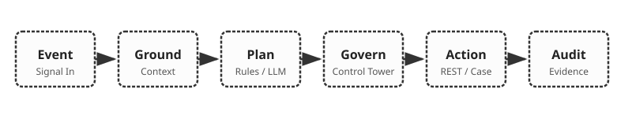
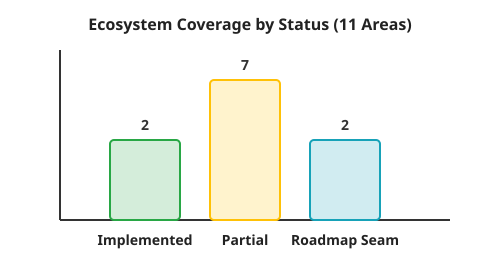
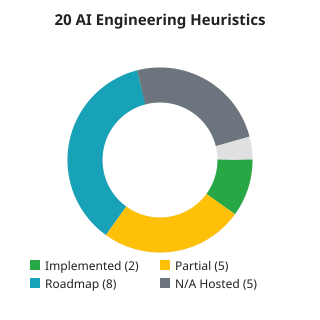
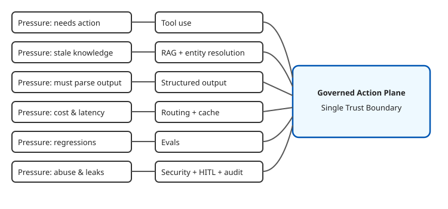
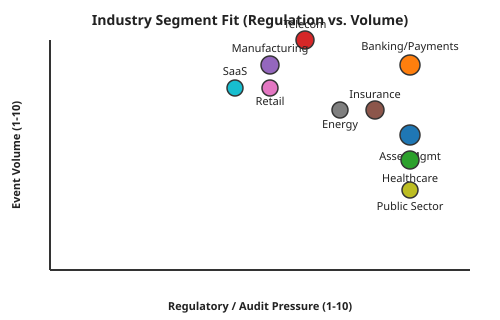
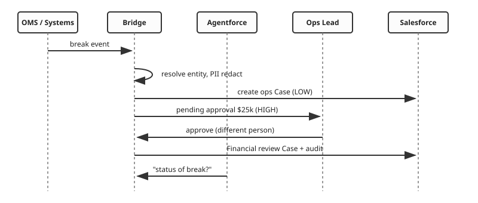
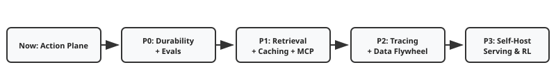

# Ecosystem, Heuristics & Industry Mapping

### How `salesforce-agentforce-enterprise-bridge` maps to the Modern AI Ecosystem, the 20 AI Engineering Heuristics, and real industry use-cases

> [!IMPORTANT]
> ✅ **Implemented** (in the repo, tested) · 🟡 **Partial** (simulated or minimal version) · 🛣️ **Roadmap** (designed seam, not built) · ⛔ **N/A (hosted)** (provider-side concern unless you self-host models).
> The reference implementation is deliberately narrow: it is a **governed action plane**, not a full AI platform.

# 1 · The one-paragraph answer

Most AI roadmaps list *tools*. The bridge targets the part that decides whether AI ever reaches production in a regulated enterprise: **turning an event into a trustworthy decision and a governed action, with proof.**

$$
\text{Event} \xrightarrow{\text{ground}} \text{Context} \xrightarrow{\text{plan}} \text{Proposal} \xrightarrow{\text{govern}} \text{Action} \xrightarrow{\text{audit}} \text{Evidence}
$$

It touches **7 of the 9 ecosystem areas** (LLM, agentic, RAG, embeddings, security, observability, memory — at differing depths), ships **2 of 20 heuristics fully** (tool use, structured output), **5 partially**, and has explicit seams for **8 more**; **5 are serving-layer techniques** that only matter if you self-host models.

# 2 · Modern AI Ecosystem — coverage map

The ecosystem graphic has **11 branches** (nine in the text post plus *Vector Database* and *Automation* shown in the image).

| # | Ecosystem area | Status | What the solution does | Where | Production swap / next step |
|---|---|---|---|---|---|
| 1 | **Foundation models (LLMs)** | ✅ | Claude via Messages API; provider-neutral `Planner` protocol | `agent.py::AnthropicPlanner` | Any provider/Ollama/vLLM; Salesforce Models API to stay inside one trust boundary |
| 2 | **Agentic AI** | 🟡 | Planner ⟂ tools separation; Agentforce is the agent runtime; deterministic DAG for one decision | `pipeline.py`, `actions.py` | LangGraph/Strands for multi-step tool loops (same Control Tower) |
| 3 | **RAG** | 🟡 | Account-scoped retrieval of similar incidents feeding the planner | `grounding.py` | Data Cloud search index / RAGFlow / GraphRAG for relationship-heavy data |
| 4 | **Embedding models** | 🟡 | Deterministic feature-hashing embeddings (512-d, signed, L2-norm) | `grounding.py::embed` | OpenAI/Cohere/Voyage/BGE/Vertex embeddings; Data Cloud vectorisation |
| 5 | **MCP** | 🛣️ | Action manifest (name, JSON-Schema, risk, permission) is *MCP-tool-shaped* | `/v1/actions`, `/openapi.json` | Expose the registry as an MCP server; consume Salesforce-hosted MCP servers |
| 6 | **AI security** | ✅/🛣️ | PII redaction (SSN, Luhn card, email, phone), prompt-injection containment, RBAC, allow-listed actions, SOQL escaping | `pii.py`, `control_tower.py`, `rbac.py` | Presidio (NER), NeMo Guardrails / Guardrails AI, Lakera Guard, Bedrock/Azure content safety |
| 7 | **Observability** | 🟡 | Decision counters, latency quantiles, fallback & mirror-failure counters, readiness, audit trail | `metrics.py`, `audit.py` | Langfuse / Phoenix / LangSmith traces; Ragas/TruLens for RAG quality; OpenTelemetry |
| 8 | **Memory** | 🟡 | Bounded per-account history (short-term, entity-scoped); audit as durable record | `grounding.py` | Data Cloud profile as long-term memory; Mem0/Zep/Letta for conversational memory |
| 9 | **Agent frameworks** | 🟡 | Typed contracts with pydantic (PydanticAI-style discipline); Agentforce as managed framework | `models.py` | OpenAI Agents SDK / Semantic Kernel / Google ADK / Bedrock Agents where the customer standardises |
| 10 | **Vector database** | 🟡 | In-memory bounded index per account | `VectorIndex` | pgvector / Data Cloud / Pinecone / Qdrant / Elasticsearch |
| 11 | **Automation / orchestration** | 🛣️ | Async bus, retry, breaker, DLQ | `bus.py`, `resilience.py` | Temporal / Airflow / Prefect for durable retries & replays; n8n / Power Automate for citizen-built flows; Kafka for ingest |

> [!NOTE]
> **Senior-engineer takeaway from the roadmap graphic:** *"Don't just learn AI tools; learn how to connect them to solve real-world problems."* The bridge is exactly that connective tissue — contracts, grounding, governance, and audit between the model and the business system.

# 3 · The 20 AI engineering heuristics — applied

Each heuristic is a *pressure → technique* pair. Below: whether this solution already applies it, how, and where it would bite as you scale.

## 3.1 Context & retrieval (1–4)

| # | Pressure → Technique | Status | In this solution |
|---|---|---|---|
| 1 | New knowledge + generation → **RAG** | 🟡 | Planner receives *retrieved, account-scoped* facts (event count, exposure, similar incidents ≥ 0.5 cosine) instead of free recall |
| 2 | Keyword + semantic → **Hybrid search** | 🟡 | Entity resolution is exact + fuzzy (lexical); similarity is hashed-lexical. Add BM25 + dense embeddings with rank fusion |
| 3 | Retrieval + noise → **Reranker** | 🛣️ | Today: top-k with min score. Add a cross-encoder reranker once the corpus is large (retrieve 50 → rerank to 5) |
| 4 | Long prefix + many calls → **Prompt cache** | 🛣️ | System prompt is static by design (cache-friendly). Enable provider prompt caching; keep variable event JSON *after* the stable prefix |

## 3.2 Training & adaptation (5–8)

| # | Pressure → Technique | Status | In this solution |
|---|---|---|---|
| 5 | Labels + behaviour → **SFT** | 🛣️ | Every human **approve/reject/override** is a labelled (event, context)→action example — free supervision |
| 6 | Fine-tune + single GPU → **LoRA** | 🛣️ | If a small open model replaces the API planner, adapt with LoRA on the override-derived dataset |
| 7 | Verifiable output + no labels → **GRPO** | 🛣️ | Rewards are auto-checkable: *schema-valid ∧ action-allowed ∧ not-overridden ∧ idempotent*. A natural RL-with-verifiable-rewards setup |
| 8 | Big model + cheap inference → **Distillation** | 🛣️ | Distil frontier-model decisions into a small, cheap triage model; keep the large one for hard cases |

## 3.3 Inference & serving (9–16)

| # | Pressure → Technique | Status | In this solution |
|---|---|---|---|
| 9 | Big model + OOM → **Quantization** | ⛔ | Hosted API; relevant only if self-hosting (e.g., vLLM/Ollama on-prem for data-sovereignty customers) |
| 10 | Long generation + latency → **KV cache** | ⛔ | Provider-side. Outputs here are short JSON (≤ 512 tokens), so decode cost is small |
| 11 | Memory + fragmented → **PagedAttention** | ⛔ | vLLM feature; n/a to hosted usage |
| 12 | Draft + target → **Speculative decoding** | ⛔ | Provider/server feature; n/a |
| 13 | Variable requests + throughput → **Continuous batching** | 🟡 | *App-layer analogue:* bounded queue + worker pool keeps workers busy under variable load, with 429 backpressure |
| 14 | Small + large model → **Model routing** | 🟡 | Rules-first baseline, LLM as upgrade, automatic fallback. Next: route *only low-confidence* events to the LLM |
| 15 | Meaning + cache → **Semantic cache** | 🛣️ | Recurring alerts ("gateway outage…") are highly repetitive → cache decisions by embedding similarity with TTL and per-account scope |
| 16 | Long prompts + fast tokens → **Disaggregated serving** | ⛔ | Self-hosting concern (prefill vs decode pools); n/a |

## 3.4 Agents & quality (17–20)

| # | Pressure → Technique | Status | In this solution |
|---|---|---|---|
| 17 | Model + external APIs → **Tool use** | ✅ | `ActionRegistry`: typed, permissioned, risk-tiered tools exposed via OpenAPI; model can only *request*, Control Tower *executes* |
| 18 | Context + overflow → **Sub-agents** | 🛣️ | Pipeline is single-step; per-account scoping is the analogue. For multi-step investigations delegate to sub-agents that return *summaries*, not raw logs |
| 19 | Text + JSON → **Structured output** | ✅ | JSON-only planner contract → pydantic `Plan`; params re-validated against action schemas; invalid → fallback/reject |
| 20 | Prompts + regression → **Evals** | 🟡 | 47 deterministic tests incl. adversarial planner outputs (100 % line+branch). Golden-set evals + shadow mode are the next gate |

# 4 · "Name the pressure" — five tensions this solution resolves

> *"Once you can name the pressure, the technique becomes obvious."*

| Production pressure | Naive failure | Technique(s) applied here | Evidence |
|---|---|---|---|
| **Model knows things, can't act safely** | Free-form tool calls | Tool use + structured output + governance | `ActionRegistry`, `ControlTower` |
| **Fluent but ungrounded** | Hallucinated customer facts | RAG-style grounding, entity resolution, tenant-scoped retrieval | `GroundingService` |
| **Non-determinism vs. audit** | "Why did it do that?" | Deterministic baseline, full audit, schema-validated proposals | `RuleBasedPlanner`, `AuditLog` |
| **Cost/latency vs. quality** | LLM on every event | Rules-first routing, fallback, (roadmap) semantic cache + routing | `ResilientPlanner` |
| **Prompt changes break behaviour** | Silent regressions | Evals-as-tests, adversarial outputs, 100 % coverage gate; (roadmap) golden set | `tests/`, CI |

# 5 · The real-world problem

Every industry has the same shape of problem:

> **High-volume operational signals arrive from many systems; a small fraction need an action in a system of record; some actions are consequential; a regulator or auditor will ask who decided and why.**

| Pain today | Consequence | What the bridge changes |
|---|---|---|
| Signals fragmented across ERP / payments / IoT / logs | Slow, inconsistent triage; duplicate work | Contract + dedupe + entity resolution → one unified view per customer |
| AI pilots stall at security/compliance review | Value never reaches production | PII stripping, RBAC, risk tiers, human approval, audit — *built in, testable* |
| Agents act on stale/untrusted context | Wrong or unsafe actions | Account-scoped grounding; validated, allow-listed actions |
| No evidence trail | Audit findings; regulatory exposure | `Bridge_Audit_Log__c` for every decision (executed, pending, denied, rejected, failed) |
| Integration brittleness | Outages cascade | Backoff + jitter, circuit breaker, DLQ, outbox replay |

# 6 · Industry segment mapping

| Segment | Operational signal (event) | LOW-risk autonomous action | HIGH-risk (human-approved) action | Salesforce surface | Typical compliance drivers* | Value metric |
|---|---|---|---|---|---|---|
| **Asset / wealth management** | Trade-break, reconciliation mismatch, KYC/AML alert | Open ops Case, enrich with account context | Financial review hold; escalation to compliance | Financial Services Cloud, Service Cloud | SEC/FINRA recordkeeping, SOX | Break-resolution time; audit-prep hours |
| **Banking & payments** | Gateway outage, card-decline spikes, chargeback signals | Create incident Case; notify relationship manager | Merchant account freeze / credit | FSC, Service Cloud | PCI-DSS, GLBA, SOX | Auth-rate recovery; dispute cycle time |
| **Insurance** | FNOL/claims anomalies, policy-admin errors, fraud flags | Create claim-exception Case | Payout hold/release; SIU referral | Financial Services Cloud (Insurance) | State insurance regulation, SOX | Claim cycle time; leakage reduction |
| **Healthcare & life sciences** | Device telemetry, billing denials, supply alerts | Care-team or billing-ops Case | Patient-account adjustments (PHI-safe) | Health Cloud, Service Cloud | HIPAA, GxP | Denial turnaround; PHI-incident risk avoided |
| **Telecom & media** | Network/KPI degradations, provisioning failures | Customer-impact Case, proactive notification | SLA credits / bulk remediation | Communications Cloud | CPNI/privacy, SLA contracts | MTTR; credits avoided |
| **Manufacturing & IoT** | Machine telemetry, quality drift, warranty claims | Field-service Case | Line stoppage / recall escalation | Manufacturing Cloud, Field Service | ISO 9001, safety regs | Downtime hours; warranty cost |
| **Retail & e-commerce** | Payment failures, fulfilment exceptions, fraud signals | Order-exception Case | Refund above threshold; account block | Commerce / Service Cloud | PCI-DSS, consumer-protection laws | Cart-recovery; refund leakage |
| **Energy & utilities** | Outage/smart-meter anomalies, billing disputes | Service Case, crew-dispatch request | Large-customer billing adjustment | Energy & Utilities Cloud | Utility-commission rules, NERC CIP (ops tech) | Outage-case handling time |
| **Public sector** | Benefit-processing exceptions, case backlogs | Triage and route Case | Eligibility/benefit overrides | Public Sector Solutions | FedRAMP-style controls, records laws | Backlog burn-down; auditability |
| **SaaS / high-tech** | Product telemetry, churn/health signals, incident feeds | Support/CS Case; success-plan nudge | Credits, contract exceptions | Service / Sales Cloud | SOC 2, GDPR | Time-to-resolve; retention |

\*Illustrative regimes, not legal advice; confirm per customer.

> [!TIP]
> **Sweet spot = top-right** (high regulation *and* high volume): banking/payments and asset management — which is also where the candidate's résumé is strongest (J.P. Morgan AM / Highbridge, Balyasny, Millburn). Lead with that; show breadth second.

# 7 · Worked scenarios

## 7.1 Asset management — reconciliation break (resume-aligned)

*Heuristics in play:* RAG, tool use, structured output, evals, (roadmap) semantic cache for repeating breaks.

## 7.2 Banking/payments — gateway outage with card data in logs

Events contain card numbers and emails → **redaction before prompts and CRM**; repeated declines (≥3 events) escalate priority; refunds/freeze actions are HIGH-risk. *Heuristics:* security + HITL, hybrid search over incident text, prompt cache for the static policy prefix.

## 7.3 Manufacturing/IoT — machine drift

Telemetry floods (high volume) → **rules-first routing** keeps LLM cost near zero; only ambiguous patterns go to the model; Field Service Case auto-created; line-stop actions HIGH-risk. *Heuristics:* model routing, semantic cache, continuous batching analogue (bounded queue), (roadmap) distillation of triage into a small model.

## 7.4 Healthcare — billing denials with PHI

Redaction (extended with NER) + least-privilege + audit are the *entry ticket*; self-hosted open models (quantization, vLLM serving) may be required for data residency — that is when heuristics 9–16 stop being N/A.

# 8 · Closing the gaps — prioritised roadmap by heuristic

| Priority | Gap | Heuristic(s) | Why first | Effort |
|---|---|---|---|---|
| P0 | Durable approvals/outbox, idempotent audit upsert | — (production hygiene) | Unblocks multi-replica and restarts | M |
| P0 | Golden-set evals + shadow mode + CI gate | #20 Evals | Without it, no safe expansion of autonomy | M |
| P1 | Real embeddings + hybrid search + reranker | #2, #3, #1 | Biggest quality lever for grounding | M |
| P1 | Prompt cache + semantic cache + confidence routing | #4, #15, #14 | Cuts cost/latency on repetitive alerts | M |
| P1 | MCP server exposing the registry; NER PII (Presidio); guardrails | MCP, Security | Ecosystem interoperability and defence in depth | M |
| P2 | Langfuse/Phoenix traces; Ragas-style retrieval metrics | Observability | Debuggable agent traces | S |
| P2 | Override-derived dataset → SFT/LoRA → distilled triage model | #5, #6, #8 | Lower unit cost at volume | L |
| P3 | GRPO with verifiable rewards | #7 | Advanced; only if volume justifies | L |
| P3 | Self-hosted serving (quantization, KV/paged attention, speculative decoding, disaggregation) | #9–12, #16 | Only for sovereignty-driven customers | L |

# 9 · Talking points

**60-second version:** *"The ecosystem has dozens of tools; the hard part is the connective tissue. My bridge is a governed action plane: it grounds the model, constrains it to typed tools, forces consequential actions through a human, and records evidence — so a regulated customer can approve it. In heuristic terms, it implements tool use and structured output, partially implements RAG, routing, hybrid retrieval and evals, and has explicit seams for caching, reranking, fine-tuning and distillation."*

| If the panel asks… | Say… |
|---|---|
| "Which of the 20 heuristics did you use?" | "Two fully, five partially — and I can name the pressure that would trigger each of the rest." |
| "Why no fine-tuning?" | "No labels yet. Human overrides will create them; SFT/LoRA/distillation come after evals prove a gap." |
| "Why not quantization / vLLM?" | "Hosted models. Those become relevant when data residency forces self-hosting — I've mapped that path." |
| "Where does MCP fit?" | "The action manifest is already tool-shaped; exposing it as an MCP server is a thin adapter. Salesforce also offers hosted MCP servers." |
| "Which industry first?" | "Asset management and payments — high regulation, high volume, and where I have shipped before." |
| "What did you *not* build?" | "Real Kafka, durable state, Data Cloud itself, real embeddings. All listed with a priority in section 8." |

> [!CAUTION]
> Never describe the simulated pieces (Data Cloud grounding, hashing embeddings, offline benchmark) as production-proven. The candour is part of the pitch.