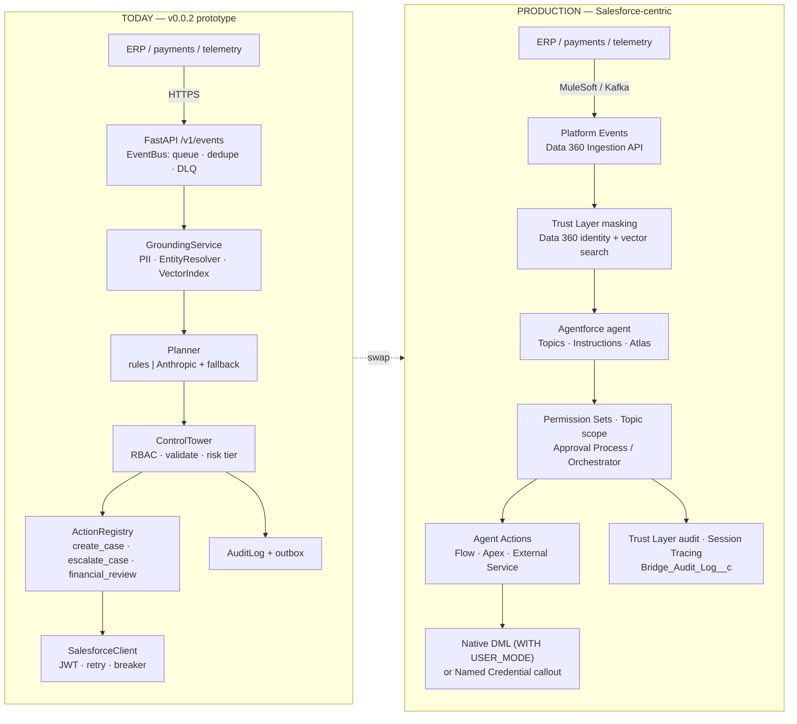
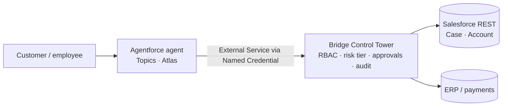
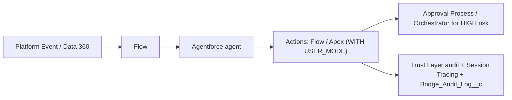
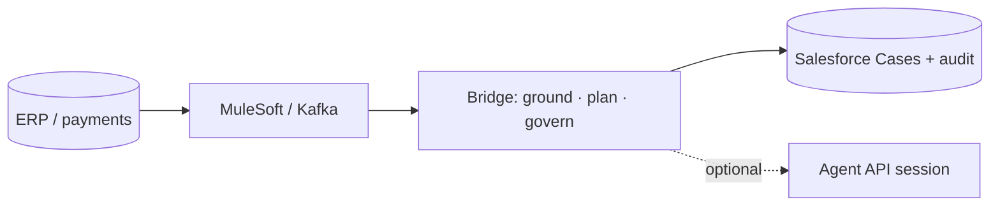

# BRIDGE_TO_SALESFORCE_MAPPING.md
### Where each component of the Agentforce Enterprise Bridge (v0.0.2) lands in the Salesforce platform — and what you would swap in for production

> **Caveat:** Agentforce, Data 360 and Trust Layer product names, limits and GA status change every release. Anything marked **(verify)** must be confirmed on `help.salesforce.com` / `developer.salesforce.com` before it goes into a customer design.
>
> **Scope note:** this maps the code that actually exists in this repository (55 tests, 100 % line+branch coverage). It does **not** claim features the repo lacks (no OPA, no Postgres journal, no shadow mode, no golden-set eval harness, no Platform Events, no External Client App metadata file). Those appear as *gaps*, not as capabilities.

**Verdict key** — 🔁 **Replace** with the native feature · 🤝 **Hybrid** (native + a thin external piece) · 🛡️ **Keep** (no real native equivalent) · ✅ **Already real Salesforce** (the bridge uses the actual thing) · 🧪 **Simulation** (prototype stand-in; swap before production)

---

## 1. The short answer

The bridge is a **governed action plane wrapped around an agent**: *ingest → ground → plan → govern → act → audit*. Salesforce already ships a native counterpart for most layers (Platform Events, Data 360, Agentforce Topics/Actions, Einstein Trust Layer, Permission Sets, Approval Processes, Testing Center). In a Salesforce-centric production build you **swap the commodity layers for the native ones** and keep an external service only where the customer needs something Salesforce does not provide — chiefly **one enforcement point for non-Salesforce systems and external approvers**. Every swap point in the code is a seam: `SalesforceGateway`, `Planner`, `ActionRegistry`, and `EventBus`.

---

## 2. Today vs. production



---

## 3. Master mapping (component → Salesforce equivalent → verdict)

### 3.1 Ingest & eventing
| Bridge component (file) | Salesforce equivalent | Verdict | Notes for the swap |
|---|---|---|---|
| `POST /v1/events` + `TelemetryEvent` with `extra="forbid"` (`api.py`, `models.py`) | **Platform Events** (`Telemetry_Event__e`), **Pub/Sub API**, **Data 360 Ingestion API** (streaming/bulk) | 🤝 | Salesforce-origin signals → Platform Event or CDC. Non-Salesforce sources keep an HTTPS front door, ideally MuleSoft/Kafka in front. The strict contract becomes the Platform Event field list / Ingestion API schema. |
| `EventBus`: bounded `asyncio.Queue`, N workers, HTTP 429 (`bus.py`) | Platform Event delivery + Apex trigger / Flow subscriber; Pub/Sub API consumer | 🔁 | Backpressure becomes publish allocations + retry; resume with **ReplayId**; heavy fan-out → Queueable. |
| Dedupe: FIFO seen-set of 10 000 `event_id`s (`bus.py`) | **External ID + `upsert`**; ReplayId; Data 360 primary key | 🔁 | `Event_Id__c` is *already* a unique External ID in `force-app/`, so switching the mirror from `create` to `upsert` gives restart-proof idempotency (currently a roadmap item). |
| DLQ deque for schema drift / handler errors (`bus.py`) | Platform Event retry config, `EventBus.RetryableException`, custom `Failed_Event__c`, Anypoint MQ DLQ | 🤝 | Surface failures in a list view/LWC for support. |
| `Telemetry_Event__c` mirror (`pipeline.py`, `force-app/`) | Same object ✅ for low volume; **Big Object / Data 360 DLO** for high volume | ✅ / 🤝 | Custom-object rows consume data storage — move high-cardinality telemetry off the CRM. |

### 3.2 Grounding (the "Data 360-style" layer)
| Bridge component (file) | Salesforce equivalent | Verdict | Notes |
|---|---|---|---|
| `pii.py` — SSN, Luhn-valid card, e-mail, phone | **Einstein Trust Layer data masking** (mask before LLM, demask after); **Shield Platform Encryption**; Data 360 governance policies | 🔁 | Trust Layer covers in-platform LLM traffic. Keep `pii.py` where data leaves Salesforce (external planner calls, logs, audit payloads). Note: regex ≠ NER — names/addresses are not caught. |
| `EntityResolver` — normalise + difflib cutoff 0.88 (`grounding.py`) | **Data 360 Identity Resolution** (match + reconciliation rules → Unified Account) | 🔁 | Fuzzy threshold becomes a declarative match-rule setting. |
| `UnifiedEvent` (`models.py`) | **DMO** mapped from a **DLO** | 🔁 | DLO→DMO mapping in the data stream; custom DMO if no standard fits. |
| Per-account `event_count`, `exposure_usd`, `max_severity` (window of 100) | **Calculated Insights** (batch SQL) / **Streaming Insights** | 🔁 | Windowed aggregates are a native strength. |
| `embed()` (512-d signed feature hashing) + `VectorIndex` (`grounding.py`) | **Data 360 vector database / search index**, retrievers (hybrid search), managed embedding models | 🧪 → 🔁 | **First thing to replace.** Hashing is lexical, not semantic; use real embeddings, chunking and retriever testing. |
| Tenant isolation = one index/history per account key | Sharing model + **Data Spaces** | 🔁 | Enforce in the data layer, not app code. |

### 3.3 Planning & reasoning
| Bridge component (file) | Salesforce equivalent | Verdict | Notes |
|---|---|---|---|
| `RuleBasedPlanner` — amount ≥ threshold → financial review; low severity → none; severity/recurrence → priority (`agent.py`) | **Flow Decision / Apex** deterministic logic; **Agent Script / hybrid reasoning** *(verify GA)* | 🔁 | Business rules belong in Flow/Apex, not prompts. Threshold → **Custom Metadata** (`Bridge_Config__mdt`). |
| `AnthropicPlanner` — JSON-only, `<event>` as untrusted data, action allow-list | **Agentforce agent**: Topic (classification + scope + instructions) + Actions; **Prompt Builder**; model choice via Trust Layer / BYO model *(verify)* | 🔁 | "Event text is data" and "action must be registered" become topic scope + action availability filters. |
| `ResilientPlanner` — any LLM failure → rules | Agent fallback/escalation topic → **Omni-Channel** human hand-off; Flow fault paths | 🔁 | |
| Prompt-injection defence = delimiters + allow-list + validation (no dedicated screen) | **Trust Layer prompt defense**, toxicity/output scoring, Agentforce guardrails | 🔁 | Keep a pre-screen only if untrusted text reaches the agent from outside Salesforce. |

### 3.4 Governance (the Control Tower)
| Bridge component (file) | Salesforce equivalent | Verdict | Notes |
|---|---|---|---|
| `ActionRegistry` + `manifest()` (`actions.py`) | **Agent Actions**; **External Services**; Apex `@InvocableMethod`; Flow | ✅ / 🔁 | `GET /openapi.json` is exactly what an External Service registration consumes. Each `ActionDefinition` = one Agent Action with typed inputs and a rich description. |
| Pydantic parameter models (regex on case id, length bounds, `Literal` priority) | Invocable input typing, `@InvocableVariable(required=true)`, validation rules | 🔁 | |
| `RbacPolicy`: VIEWER / AGENT / APPROVER / ADMIN (`rbac.py`) | **Profiles, Permission Sets / Groups**, FLS, sharing; the **agent's running user** | 🔁 | `Bridge_Integration` permission set in `force-app/` is already real ✅ (create/read telemetry + audit, Case create/edit, Account read, no delete). |
| Risk tiers LOW / HIGH (`RiskTier`) | Action metadata + confirmation step; **Approval Process**; **Flow Orchestrator** | 🔁 | HIGH ⇒ approval request routed to a queue or role. |
| `ApprovalStore` — in-memory, TTL 900 s, cap 1000 (`approvals.py`) | **Approval Process** (`ProcessInstance*`), **Flow Orchestrator** stages, Omni-Channel work items | 🔁 | Native adds UI, e-mail, mobile, delegation and escalation timers — and fixes the prototype's *not restart-safe* limitation. |
| Separation of duties — requester ≠ approver by principal **name** (`control_tower.py`) | Approval Process "approver cannot be submitter"; manager-hierarchy routing | 🤝 | Native is org-user based. Keep an identity check if approvers come from an external IdP. |
| `ControlTower.submit` — redact → validate → risk gate → execute (`control_tower.py`) | Permission Sets + Topic scope + Flow/Orchestrator + Trust Layer | 🤝 | In a fully native design this becomes several Salesforce features; the *single choke point* is the architectural idea worth keeping. |
| `AuditLog` + bounded outbox → `Bridge_Audit_Log__c` (`audit.py`) | **Trust Layer audit trail**, **Session Tracing**, **Event Monitoring**, **Field Audit Trail** / Shield | 🤝 | Native traces prompts/tool calls inside the org; keep `Bridge_Audit_Log__c` for **cross-system decisions** (approver, external action). |
| `Metrics` — decision counters, p50/p95 (`metrics.py`, `/metrics`) | Agentforce analytics / Command Center *(verify)*, **CRM Analytics / Tableau**, Event Monitoring | 🤝 | Prometheus stays for the bridge's own SLOs. |

### 3.5 Salesforce connectivity
| Bridge component (file) | Salesforce equivalent | Verdict | Notes |
|---|---|---|---|
| `SalesforceClient` — REST create/update/paginated SOQL (`salesforce.py`) | Native DML/SOQL in Apex/Flow (`WITH USER_MODE`); REST / **Composite** (≤ 25 subrequests) / Bulk API 2.0 externally | ✅ / 🔁 | If logic moves in-org there is no client at all. If it stays external, add Composite batching. |
| **JWT Bearer** auth, RS256, cert upload (`jwt_auth.py`) | **External Client App** (new) / Connected App (legacy), JWT Bearer flow | ✅ | The repo documents the manual ECA setup but ships **no ECA metadata file** — a gap; add one to `force-app/` for repeatable deploys. |
| Client-credentials fallback | ECA client-credentials flow, run-as user | ✅ | |
| `retry_async` + `CircuitBreaker` (`resilience.py`) | Queueable retry, Platform Event retry; **MuleSoft policies** (rate-limit, retry, circuit-breaker) | 🤝 | In-org callers: Named Credential + Queueable (`Database.AllowsCallouts`) + counter; breaker state in Platform Cache / custom setting. |
| 401 refresh, 429/5xx classification; `/limits` in `verify()` | `REQUEST_LIMIT_EXCEEDED`, `Sforce-Limit-Info` header | ✅ | Add `Sforce-Limit-Info` to the metrics. |
| Account lookup by `Name` + `soql_quote` | SOQL by **External ID**, matching rules, Data 360 unified profile | 🔁 | Name lookup is a prototype shortcut; use IDs. |
| Secrets via env vars / `.env` / GitHub Environment secrets | **Named Credential + External Credential** (no secrets in metadata) | 🔁 | In-org callouts never handle secrets; the external side keeps a secret manager. |

### 3.6 Exposure & channels
| Bridge component | Salesforce equivalent | Verdict | Notes |
|---|---|---|---|
| `GET /v1/actions`, `/openapi.json` | External Service → invocable action → Agent Action | ✅ (designed for it) | The Agentforce contract. |
| `POST /v1/actions/{name}` (202 = pending approval) | Agent action execution via Named Credential | 🤝 | Pattern 1 below. |
| `X-API-Key` → principal map (`api.py`, `config.py`) | OAuth 2.0 via ECA, SSO/OIDC for humans | 🔁 | Keys are plain strings in env today (compared in constant time); production → OIDC bearer. |
| `GET /v1/approvals`, `POST .../decision` | Lightning approval inbox, Orchestrator work items, Slack approvals | 🔁 | |
| `/healthz`, `/readyz` | Salesforce Trust status for the platform; k8s probes for the sidecar | 🛡️ | |

### 3.7 Quality & delivery
| Bridge component | Salesforce equivalent | Verdict | Notes |
|---|---|---|---|
| 55 pytest tests, 100 % line+branch gate | Apex tests (75 % org minimum), Flow tests, **Agentforce Testing Center** | 🤝 | The repo has **no golden-set eval corpus yet**. Build one from approver overrides, then run it in Testing Center. |
| `bridge bench` | Load tests in a full sandbox | 🛡️ | |
| GitHub Actions `ci`, `security`, `live-integration`, `release` | `sf` CLI pipelines, **DevOps Center**, scratch orgs, unlocked packages | 🤝 | |
| `salesforce-deploy.yml` + `force-app/` | `sf project deploy start`, sandbox promotion Dev → Partial → Full → Prod | ✅ | Add `sf apex run test` before promotion. |
| `Dockerfile`, `docker-compose.yml` | Heroku, customer K8s, MuleSoft Runtime Fabric | 🛡️ | Host where the customer's security team allows. |

---

## 4. Three production patterns (choose per customer)

### Pattern 1 — **Agentforce + external governance sidecar** (most common)

**Swap in:** Agentforce, Data 360, Trust Layer. **Keep:** the Control Tower as the single enforcement point, `Bridge_Audit_Log__c`. **Choose when:** actions span non-Salesforce systems or approvers sit outside Salesforce.

### Pattern 2 — **Fully native**

**Swap in:** everything marked 🔁. The bridge becomes a **test bench** and design reference. **Choose when:** all systems are Salesforce-mastered and governance is simple.

### Pattern 3 — **Event-driven integration front end**

**Swap in:** Kafka/MuleSoft for the in-process `EventBus`; Data 360 for grounding. **Choose when:** high-volume non-Salesforce signals dominate and Salesforce is the system of action.

---

## 5. Concrete swap-in recipes

### 5.1 Expose the bridge to Agentforce (Pattern 1)
1. **External Credential + Named Credential** → `https://bridge.customer.net`; custom-header auth injects `X-API-Key` (or OIDC bearer); grant the principal through a **Permission Set**.
2. **External Services** → register `https://bridge.customer.net/openapi.json` (verify the generated spec fits the supported OpenAPI subset) → invocable actions for `create_case`, `escalate_case`, `create_financial_review`.
3. Add each as an **Agent Action** on a topic; write precise input/output descriptions — they drive tool selection.
4. Topic text (keep decisions in the bridge, not the prompt):
```text
Topic: Operational Incident Triage
Classification: Use when a monitored system reports a payment, billing or latency problem for a customer account.
Scope: Opens Cases, requests escalations and financial reviews. Does not issue refunds or change pricing.
Instructions:
1. Call "create_case" for medium/high incidents using the account_name from the event; never guess the account.
2. For amounts at or above the financial threshold call "create_financial_review" and tell the user it needs human approval.
3. If the result status is 202 / pending_approval or 403 denied, explain once and do not retry.
4. Never reveal internal ids, approval ids, or other customers' data.
```
5. HTTP semantics the agent must handle: **200** executed · **202** pending approval · **403** denied · **422** rejected (bad params) · **502** failed.

### 5.2 Replace ingest + grounding natively (Pattern 2)
```text
Platform Event Telemetry_Event__e: Event_Id__c, Source__c, Account_Name__c, Severity__c, Message__c, Amount_Usd__c
Flow (platform-event-triggered):
  1. Upsert Telemetry_Event__c by Event_Id__c              ← replaces dedupe + mirror
  2. Get Unified Account (Data 360 / matching rule)        ← replaces EntityResolver
  3. Decision: Amount_Usd__c >= {!$CustomMetadata.Bridge_Config.Financial_Threshold}  ← replaces RuleBasedPlanner
  4. Invoke Agentforce action "Create Case" (or Orchestrator approval for financial review)
  5. Create Bridge_Audit_Log__c (Decision__c, Actor__c)    ← replaces AuditLog
```
Data 360: stream → DLO → DMO, identity-resolution ruleset, Calculated Insight for exposure, search index over past Cases (replaces `VectorIndex`).

### 5.3 Turn tests into evals
| Today (this repo) | Target |
|---|---|
| Rule-planner unit tests (threshold, severity, recurrence) | Flow tests / Apex tests on the Decision element |
| Adversarial `AnthropicPlanner` outputs (disallowed action, malformed JSON) | Testing Center safety suite: "must not call `escalate_case`" |
| HITL tests (approve/reject/separation of duties) | Approval Process test scripts + UAT |
| *Missing:* golden event→action corpus | Build from approver overrides; run in Testing Center; gate releases on it |

### 5.4 Apex callout to the bridge (in-org caller)
```apex
public with sharing class BridgeActionInvoker {
  public class Req { @InvocableVariable(required=true) public String action;
                     @InvocableVariable(required=true) public String paramsJson; }
  public class Res { @InvocableVariable public Integer status; @InvocableVariable public String body; }

  @InvocableMethod(label='Bridge: Submit Action' callout=true)
  public static List<Res> submit(List<Req> reqs) {
    List<Res> out = new List<Res>();
    for (Req r : reqs) {
      HttpRequest q = new HttpRequest();
      q.setEndpoint('callout:Bridge_NC/v1/actions/' + EncodingUtil.urlEncode(r.action, 'UTF-8')); // Named Credential: no secrets in code
      q.setMethod('POST');
      q.setHeader('Content-Type', 'application/json');
      q.setBody('{"params":' + r.paramsJson + '}');
      q.setTimeout(20000);                                   // well under the 120 s callout ceiling
      HttpResponse p = new Http().send(q);
      Res o = new Res(); o.status = p.getStatusCode(); o.body = p.getBody();
      out.add(o);                                            // 202 => pending approval: surface it, never retry blindly
    }
    return out;
  }
}
```
Callouts from record-triggered paths must be asynchronous (Queueable with `Database.AllowsCallouts`).

### 5.5 Smallest high-value code change: idempotent telemetry mirror
Switch `Telemetry_Event__c` writes from `POST /sobjects/Telemetry_Event__c` to **upsert by external ID** (`PATCH /sobjects/Telemetry_Event__c/Event_Id__c/{event_id}`). The field is already unique + External ID in `force-app/`, so duplicate deliveries after a restart stop creating duplicate rows.

---

## 6. What is worth keeping outside Salesforce (and what is not)

| Capability | Native gap? | Honest take for v0.0.2 |
|---|---|---|
| One enforcement point for **non-Salesforce** actions (same RBAC/approval/audit for ERP and CRM) | Salesforce governance is scoped to Salesforce agents (MuleSoft Agent Fabric targets this, *verify*) | **Genuine reason to keep a sidecar.** |
| Approvals by **external identity** (approver in an IdP, not a Salesforce user) | Native approvals assume org users | Keep, but move identity to OIDC (`iss\|sub`), not a display name. |
| Governance logic that is **unit-testable offline** with 100 % branch coverage | Flow/Orchestrator tests are possible but heavier | Worth keeping as a *test bench* even if production is native. |
| PII redaction **before** data leaves to an external LLM or log | Trust Layer covers in-platform traffic only | Keep for the external path. |
| Policy-as-code engine (OPA/YAML), budgets, shadow mode | Partial (Flow, CMDT, guardrails) | **Not in this repo.** Treat as roadmap, not a differentiator. |

---

## 7. Honesty ledger — real vs. simulated vs. missing

| Status | Items |
|---|---|
| ✅ **Real Salesforce today** | REST create/update/SOQL, OAuth JWT Bearer + client-credentials, `Case`, custom objects, permission set, SFDX deploy workflow, live smoke test |
| 🧪 **Simulated** | Data 360 grounding (entity resolution, "DMO"), hashed embeddings, offline benchmark (no network latency) |
| ❌ **Not built** | Platform Events / Pub/Sub, ECA metadata file, native Approval Process, Testing Center corpus, shadow mode, OPA, durable Postgres/Kafka, SSO/OIDC inbound auth, Named/External Credential setup as code |

---

## 8. Recommended production end-state

| Layer | Use in production | Keep from this repo |
|---|---|---|
| Ingest | Platform Events / Data 360 Ingestion; MuleSoft for ERP | HTTP front door for non-Salesforce sources only |
| Grounding | Trust Layer masking; Data 360 identity + vector search | `pii.py` for the external-LLM path |
| Reasoning | Agentforce (Topics, Instructions, Prompt Builder) | Rules as Flow/Apex; `ResilientPlanner` idea → agent fallback |
| Actions | Flow / Apex invocable (`WITH USER_MODE`); External Service for cross-system | `ActionRegistry` OpenAPI as the contract |
| Governance | Permission Sets, Topic scope, Approval Process / Orchestrator | Control Tower as sidecar when actions span systems |
| Audit | Trust Layer audit + Session Tracing + `Bridge_Audit_Log__c` | Audit schema for cross-system rows |
| Quality | Testing Center + Apex/Flow tests | pytest governance suite as a test bench |
| Delivery | `sf` CLI, unlocked packages, DevOps Center | Docker + Actions for the sidecar |

---

## 9. Migration plan (low-risk order)

1. **Contract first:** register `/openapi.json` as an External Service in a sandbox; wire one topic and one action (`create_case`).
2. **Make writes idempotent:** upsert telemetry by `Event_Id__c`; add an External ID to Case if retries must never duplicate.
3. **Persist state:** move approvals/audit outbox off process memory (or onto native Approval Process).
4. **Replace retrieval:** Data 360 retriever instead of `VectorIndex`; compare against a golden set.
5. **Replace identity/grounding:** Data 360 identity resolution instead of `EntityResolver`; keep the entity-merge tests as acceptance tests.
6. **Shift reasoning** to the Agentforce agent; run both in parallel and diff decisions before cut-over.
7. **Decide the sidecar's fate:** retire it (Pattern 2) or keep it for cross-system governance (Pattern 1).

**Risks to design for:** Platform Event allocations and replay-retention *(verify)*; Data 360 / Einstein usage-credit costs *(verify)*; 120 s callout ceiling and governor limits; non-idempotent Case creation; at-least-once delivery; agent-user permissions (the agent must see no more than its permission set); sandbox data ≠ production data.

---

## 10. Talk track

- *"I built the control plane first, so I know why each native feature exists: Trust Layer ≈ my redaction and injection containment; Permission Sets and Topic scope ≈ my RBAC and allow-list; Approval Process ≈ my approval store; Testing Center ≈ the eval gate I still owe; Session Tracing ≈ my audit trail."*
- *"In production I'd use the native layer wherever it exists and keep an external sidecar only for cross-system governance and external-identity approvals."*
- *"Business rules belong in Flow or Apex; the model chooses among a few narrow, typed, permissioned actions."*
- *"Here is exactly what's real, simulated and missing in my build — and the first three swaps I'd make."*

---

## 11. Quick reference — repo path → Salesforce component

| Repo path | Salesforce ecosystem component |
|---|---|
| `src/bridge/bus.py` | Platform Events, Pub/Sub API, Anypoint MQ |
| `src/bridge/grounding.py`, `pii.py` | Data 360 (identity, DMO, vector search), Trust Layer masking |
| `src/bridge/agent.py` | Agentforce reasoning, Prompt Builder, Trust Layer prompt defense |
| `src/bridge/actions.py` | Agent Actions, External Services, Invocable Apex/Flow |
| `src/bridge/control_tower.py`, `rbac.py` | Permission Sets, Topic scope, action filters |
| `src/bridge/approvals.py` | Approval Process, Flow Orchestrator |
| `src/bridge/audit.py`, `Bridge_Audit_Log__c` | Trust Layer audit, Session Tracing, Event Monitoring, Field Audit Trail |
| `src/bridge/salesforce.py`, `jwt_auth.py` | REST/Composite API, JWT Bearer, External Client App |
| `src/bridge/resilience.py` | Queueable retry, MuleSoft policies |
| `src/bridge/api.py`, `config.py` | External Service endpoint, OAuth/OIDC, Named/External Credentials |
| `src/bridge/metrics.py` | Session Tracing, Event Monitoring, CRM Analytics/Tableau |
| `tests/**` | Apex/Flow tests, Agentforce Testing Center (+ pytest test bench) |
| `force-app/**` | Salesforce DX source (deployed with `sf`; unlocked package candidate) |
| `.github/workflows/salesforce-deploy.yml` | DevOps Center / `sf` CLI pipeline |
| `Dockerfile`, `docker-compose.yml` | Heroku / customer K8s / MuleSoft Runtime Fabric (sidecar hosting) |
