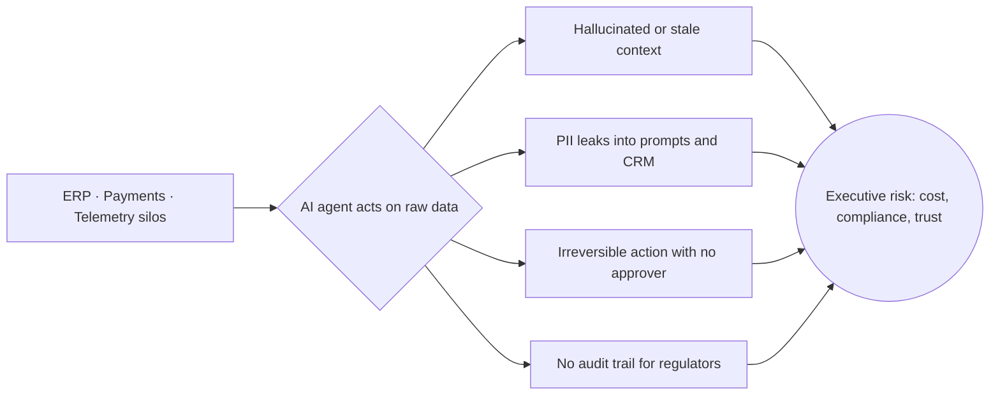
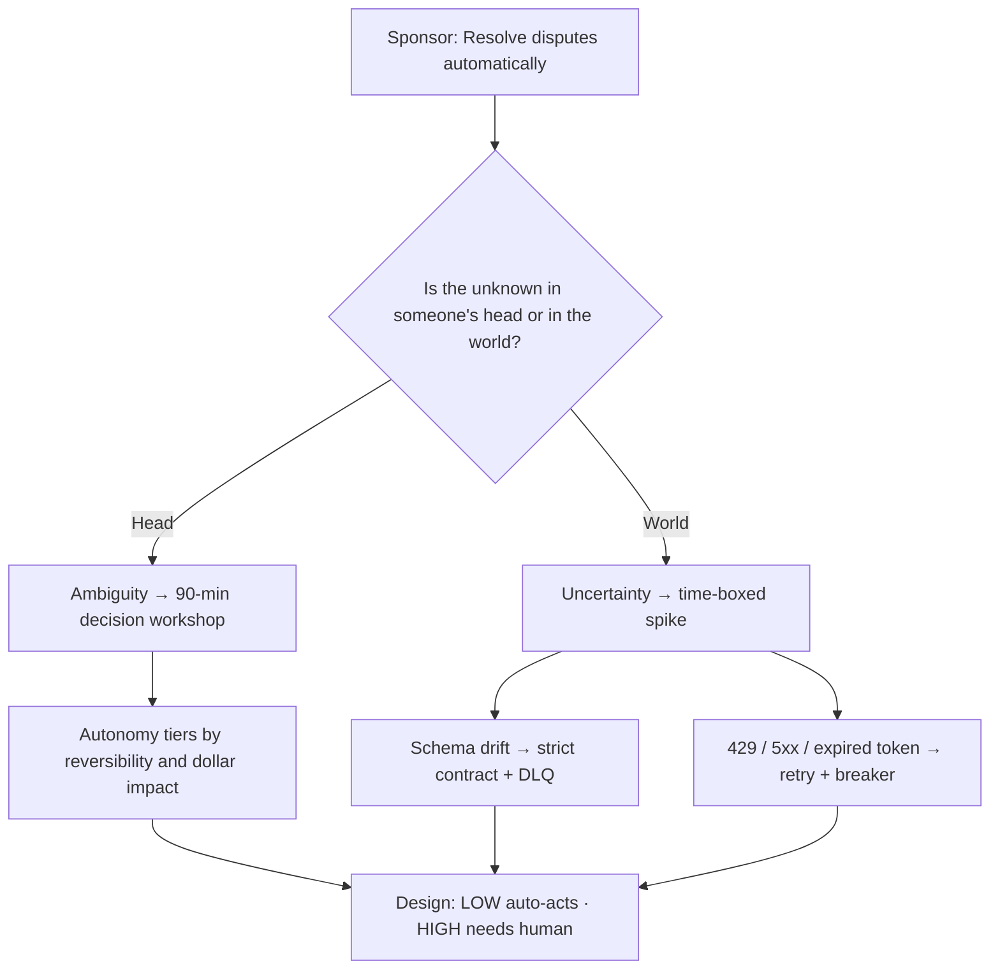
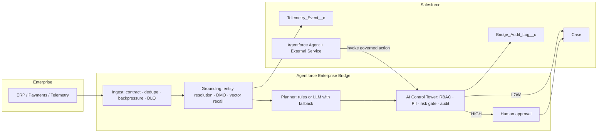
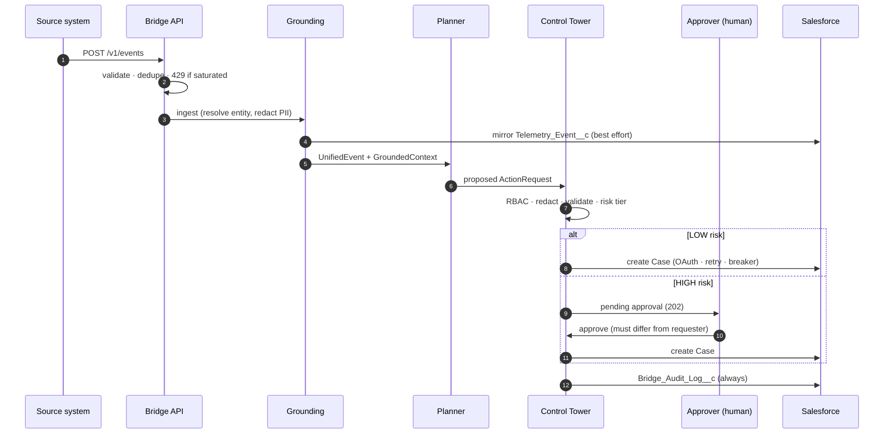
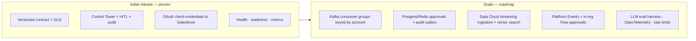
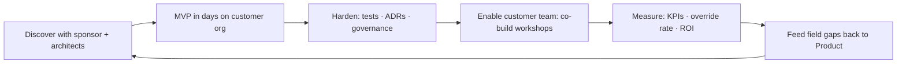
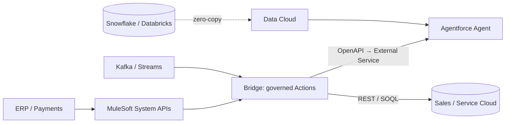
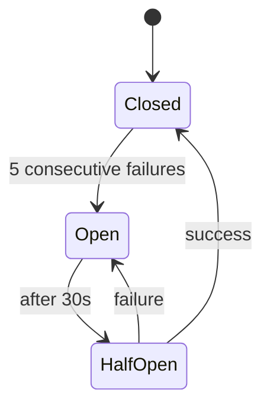
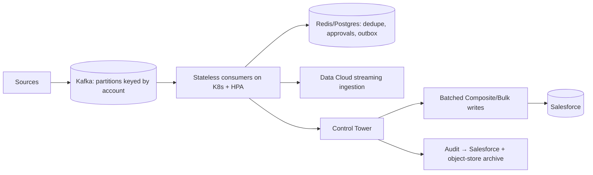

# Governed AI Agents on Salesforce {.center}

### From fragmented enterprise data to trusted, auditable action — Agentforce · Data Cloud · MuleSoft-ready {.center}

**Shaikat Majumdar** — Senior Forward Deployed Engineer · Agentic AI Systems & Enterprise Integrations {.center}

*Salesforce FDE Final Round · 2:1 panel · 15-minute walkthrough + live demo* {.center}

> [!NOTE]
> **Honesty frame (say it in the first 30 seconds):** `salesforce-agentforce-enterprise-bridge` is a *reference implementation* I built on a free Developer Org. Numbers marked **MEASURED** come from the repo's own benchmark; numbers marked **MODEL** are sizing assumptions I would validate with the customer in week one.

::pb::

# 1 · Executive summary {.center}

> [!IMPORTANT]
> **The ask of every CEO/COO:** "Let AI act on our data — without hallucinating, leaking, or doing something we can't undo or explain."
>
> **The answer:** *Ground first → plan second → govern every tool call → audit everything.*

| Leadership question | Answer in this project |
|---|---|
| Can we trust what the agent says? | Account-scoped, PII-stripped, entity-resolved grounding; outputs validated against a registry |
| Can it do anything dangerous? | No — risk-tiered actions; **financial actions require a different human to approve** |
| Can we prove what happened? | Every decision → `Bridge_Audit_Log__c` in Salesforce |
| Will it survive bad days? | Backoff + circuit breaker + DLQ + audit replay; LLM outage → deterministic fallback |
| What's the payoff? | **MODEL:** ≈ \$0.70M/yr gross at 20k alerts/yr; break-even ≈ 3.4k alerts/yr |

::pb::

# 2 · Who I am — and why it maps to this role {.center}

**17+ years** building and shipping software inside customer environments; the last decade as a forward deployed engineer in regulated finance.

| Role | What I did there | Why it matters to Salesforce FDE |
|---|---|---|
| **Balyasny** — Sr FDE & Agentic AI Lead (2025–) | Production agents for GRC/SOC; Agentforce + LangGraph; MVPs in < 5 days; co-build workshops | Same loop: discover → MVP → harden → enable customer team |
| **J.P. Morgan AM / Highbridge** — FDE & AI Platform Architect (2022–25) | Prompt/tool-routing debugging → **99.2%** task completion; ServiceNow/Archer integrations; EKS/AKS hardening; ADRs | Executive + architect stakeholder management; audit-ready services |
| **Millburn Ridgefield** — Systems & Integration Eng. (2008–22) | REST/gRPC/webhooks/Kafka; Snowflake/BigQuery; reusable SDK starter kits | Integration depth; turning field patterns into reusable assets |

> [!TIP]
> **One-liner:** "I'm the engineer who sits with the sponsor in the morning and ships the integration by Friday — then teaches the customer's team to run it."

::pb::

# 3 · The real problem {.center}



**The business problem is not "build an agent." It is "make autonomy safe enough to approve."**

- Triage today is manual: slow, inconsistent, and unauditable.
- Pilots stall at the security/compliance gate — not at model quality.
- Value is unlocked only when the *control plane* is credible to the CISO and the COO.

> [!WARNING]
> Every agent demo that skips governance is a demo the compliance lead will veto in the second meeting.

::pb::

# 4 · Discovery: ambiguity vs. uncertainty {.center}

> **Ambiguity** = the requirement is unclear → resolved by *asking people* (workshop).
> **Uncertainty** = the answer is unknown in the world → resolved by *measuring* (spike).



| Type | Example | How resolved | Result in code |
|---|---|---|---|
| Ambiguity | "Resolve" = auto-close? auto-refund? auto-triage? | COO + compliance + support workshop | `create_case` LOW · `create_financial_review` HIGH |
| Ambiguity | "Who may approve?" | Compliance | Approver ≠ requester (separation of duties) |
| Uncertainty | Will upstream schemas drift? | Contract spike | `extra="forbid"` → 422 + DLQ |
| Uncertainty | How does Salesforce behave under load? | Fault injection | Full-jitter retry, circuit breaker, 401 refresh |

::pb::

# 5 · Solution on a page {.center}



> [!NOTE]
> **Design principle:** the LLM can only *propose*. RBAC, validation, risk gating, and approval are enforced in code the model cannot talk its way past.

::pb::

# 6 · Speaking Salesforce: ecosystem mapping {.center}

| Salesforce capability | What I built (pattern) | Production swap |
|---|---|---|
| **Data Cloud** DSO → DMO → Unified Profile | `TelemetryEvent → UnifiedEvent`; `EntityResolver` | Streaming Ingestion API + native identity resolution |
| **Zero-copy federation** | Entity-scoped context; no duplicate PII stores | Snowflake / Databricks federation |
| **Data Cloud vector search / RAG** | Per-account feature-hash `VectorIndex` | Data Cloud vector search |
| **Agentforce Actions** | Metadata-driven `ActionRegistry` + OpenAPI | **External Service** → Flow action → Agent Builder |
| **Einstein Trust Layer** | PII redaction on the *external* path | Complements Trust Layer (defense in depth) |
| **MuleSoft** | REST contracts, retries, idempotency | System/Process APIs front the ERP; bridge calls Mule |
| **Platform Events / Pub-Sub** | Event bus seam | Salesforce→bridge callbacks; Kafka consumer group |
| **Permission sets / run-as** | `Bridge_Integration` least-privilege PS | Same, plus Shield event monitoring |

> [!TIP]
> Say: *"I built the pattern against a Developer Org. I haven't operated Data Cloud at customer scale — here's how I'd close that gap in my first 30 days."*

::pb::

# 7 · A request, end to end {.center}



::pb::

# 8 · Governance: autonomy by risk {.center}

```vega-lite
{
  "$schema": "https://vega.github.io/schema/vega-lite/v6.json",
  "description": "Autonomy tiers",
  "data": {"values": [
    {"action": "create_case", "tier": "LOW — autonomous", "reversibility": 8, "dollar": 2},
    {"action": "escalate_case", "tier": "HIGH — human approval", "reversibility": 5, "dollar": 6},
    {"action": "create_financial_review", "tier": "HIGH — human approval", "reversibility": 4, "dollar": 9}
  ]},
  "mark": {"type": "circle", "size": 600, "opacity": 0.85},
  "encoding": {
    "x": {"field": "reversibility", "type": "quantitative", "title": "Reversibility (higher = easier to undo)", "scale": {"domain": [0, 10]}},
    "y": {"field": "dollar", "type": "quantitative", "title": "Business / dollar impact", "scale": {"domain": [0, 10]}},
    "color": {"field": "tier", "type": "nominal", "title": "Tier"},
    "tooltip": [{"field": "action"}, {"field": "tier"}]
  },
  "width": "container",
  "height": 260
}
```

| Control | Enforced by | Proven by test |
|---|---|---|
| Least privilege | RBAC: VIEWER · AGENT · APPROVER · ADMIN | `test_rbac`, `test_api_end_to_end` |
| No PII downstream | SSN · Luhn card · email · phone redaction | `test_redact*` |
| Human on high-risk | Approval store with TTL | `test_hitl_*` |
| Separation of duties | Requester ≠ approver | `test_hitl_approve_flow` |
| Full audit | Local + `Bridge_Audit_Log__c`, outbox replay | `test_audit_outbox` |

> [!IMPORTANT]
> **Autonomy is earned by evidence:** start LOW-risk only, track the human *override rate*, expand tiers when it stays low.

::pb::

# 9 · Live demo (≈ 4.5 min) {.center}

```bash
make demo                  # offline: PII stripped · 3 spellings → 1 account · $25k held for approval
bridge manifest | head -40 # Agentforce action catalog + JSON schemas + requiresApproval
bridge demo --live         # same flow → real Cases in the Developer Org (switch to browser)
curl -s -XPOST 'localhost:8080/v1/events' -H 'X-API-Key: ak' -d '{"bogus":1}'   # 422 → DLQ (schema drift)
bridge bench -n 2000       # measured throughput and latency
```

| Beat | Say |
|---|---|
| 1 | "The email and card number never leave the bridge unredacted." |
| 2 | "'ACME Corp.' and 'Acme Corporation' resolve to one account." |
| 3 | "The agent proposes; the Control Tower disposes — the \$25k waits for a different human." |
| 4 | "Every decision is a row in `Bridge_Audit_Log__c`." |
| 5 | "Cut the network: breaker opens, `/readyz` → 503, audit outbox replays on recovery." |

> [!CAUTION]
> If the live org fails: say so calmly, run `make demo`, show screenshots. **Failing gracefully *is* the resilience story.** Never show `.env` on screen.

::pb::

# 10 · Hard problems solved {.center}

| Challenge | Naive failure | What I built |
|---|---|---|
| Schema drift | Silent bad data in CRM | Versioned contract; unknown fields → 422 + DLQ |
| Duplicate / at-least-once delivery | Duplicate Cases | Idempotent `event_id` dedupe (bounded) |
| Salesforce 429 / 5xx / token expiry | Cascading failures | Full-jitter backoff · 401 refresh · circuit breaker |
| Prompt injection via event text | Agent hijacked | Untrusted-data framing · allow-listed actions · validation · RBAC/HITL |
| LLM outage or garbage output | Pipeline stops | `ResilientPlanner` → deterministic rules |
| Cross-tenant leakage | Account A grounds Account B | Per-account vector index and history |
| Unbounded memory | OOM at scale | Bounded queue, DLQ, dedupe, history, audit, approvals |

$$
\text{Backoff}_n = U\!\left(0,\ \min(5\,\text{s},\ 0.2\cdot 2^{n})\right)
$$

::pb::

# 11 · Measured results {.center}

**MEASURED** (`bridge bench -n 2000`, offline in-memory CRM, single core — excludes real Salesforce network latency):

| Metric | Result |
|---|---|
| Throughput | ≈ **2,500 events/s** |
| Pipeline latency p50 / p95 | **0.38 ms / 0.51 ms** |
| Demo run (6 events) | 5 auto-executed · 1 held → approved · 6 audit rows · 0 unsynced |
| Test suite | **47 tests · 100 % line + branch coverage** (enforced in CI) |
| CI | Python 3.11 / 3.12 / 3.13 matrix · ruff · CodeQL · pip-audit · Docker build |

```vega-lite
{
  "$schema": "https://vega.github.io/schema/vega-lite/v6.json",
  "description": "Demo decision outcomes (measured)",
  "data": {"values": [
    {"decision": "Executed autonomously", "count": 5},
    {"decision": "Held for human approval", "count": 1},
    {"decision": "Denied / rejected / failed", "count": 0}
  ]},
  "mark": {"type": "bar", "cornerRadiusTopLeft": 4, "cornerRadiusTopRight": 4},
  "encoding": {
    "x": {"field": "decision", "type": "nominal", "sort": null, "axis": {"labelAngle": 0}, "title": null},
    "y": {"field": "count", "type": "quantitative", "title": "Events (demo set)"},
    "color": {"field": "decision", "type": "nominal", "legend": null}
  },
  "width": "container",
  "height": 220
}
```

::pb::

# 12 · Business value & ROI {.center}

> [!WARNING]
> **MODEL, not a claim.** Inputs are stated assumptions to be replaced with the customer's real volumes in week one.

$$
\text{Net}/\text{yr} = N\cdot\frac{m-(1-a)\,h}{60}\cdot r - C
\qquad
N_{\text{break-even}}=\frac{60\,C}{r\,\big(m-(1-a)h\big)}
$$

| Symbol | Meaning | Assumed |
|---|---|---|
| $N$ | alerts / year | 20,000 |
| $m$ | manual triage minutes | 25 |
| $a$ | fraction handled autonomously (LOW risk) | 0.90 |
| $h$ | human-review minutes on HIGH-risk | 3 |
| $r$ | loaded cost / hour | \$85 |
| $C$ | run cost / year (platform + LLM + support) | \$120k |

**Result:** manual ≈ 8,333 h → assisted ≈ 100 h · **gross ≈ \$0.70M/yr · net ≈ \$0.58M/yr · break-even ≈ 3.4k alerts/yr**

```vega-lite
{
  "$schema": "https://vega.github.io/schema/vega-lite/v6.json",
  "description": "MODEL: net annual savings by alert volume",
  "data": {"values": [
    {"alerts": "5k", "net": 55},
    {"alerts": "10k", "net": 230},
    {"alerts": "20k", "net": 580},
    {"alerts": "40k", "net": 1280}
  ]},
  "mark": {"type": "bar", "cornerRadiusTopLeft": 4, "cornerRadiusTopRight": 4},
  "encoding": {
    "x": {"field": "alerts", "type": "ordinal", "sort": ["5k","10k","20k","40k"], "title": "Alerts per year (MODEL)", "axis": {"labelAngle": 0}},
    "y": {"field": "net", "type": "quantitative", "title": "Net savings, \$ thousands / yr"},
    "color": {"field": "net", "type": "quantitative", "scale": {"scheme": "blues"}, "legend": null}
  },
  "width": "container",
  "height": 220
}
```

> [!TIP]
> **Beyond hours:** risk avoided — 100 % of financial actions human-approved, 100 % audited — is what unblocks a stalled pilot. That, not the hours, is the CFO/CISO conversation.

::pb::

# 13 · MVP now → scale next {.center}



| Initial release priority | Scale priority |
|---|---|
| Correctness, safety, auditability | Throughput, HA, cost |
| One happy path, human on high-risk | Multi-replica, DR, per-tenant quotas |
| Observability from day one | Golden-set evals gating releases |

> [!CAUTION]
> **Known limit (own it):** approvals and the audit retry queue are in-memory → single replica, lost on restart. First fix: Postgres + idempotent upsert on `Audit_Id__c`.

::pb::

# 14 · How I'd operate as a Salesforce FDE {.center}



| Window | Focus |
|---|---|
| **30 days** | Shadow Deployment Strategist; master Agentforce / Data Cloud in a customer context; ship one MVP |
| **60 days** | Lead a delivery pod; extract reusable Action templates |
| **90 days** | Own an outcome end-to-end; contribute structured product feedback |

> [!IMPORTANT]
> **Close:** "I don't just demo AI. I make it safe to approve, then I leave the customer able to run it without me."

::pb::

# Appendix A · Rehearsal & timing {.center}

| Min | Slide | Goal |
|---|---|---|
| 0:00 | 1–2 | Credibility + honesty frame |
| 1:30 | 3 | Make them feel the real problem |
| 3:00 | 4 | Ambiguity vs uncertainty — say the words |
| 4:30 | 5–6 | Architecture in Salesforce language |
| 6:30 | 9 | Live demo (slides 7–8 are backup/Q&A) |
| 11:00 | 10–11 | Hard problems + measured proof |
| 12:30 | 12 | ROI as a model |
| 14:00 | 13–14 | Scale + close |

- [ ] Fresh clone; `make test` shows 100 %; `.env` loaded; org logged in; Case list tab open
- [ ] Screenshots of demo as fallback; slides 7–8 held in reserve
- [ ] ROI assumptions memorised
- [ ] Two real stories ready: one win with a metric, one failure with a systemic fix
- [ ] Rehearsed aloud, timed, twice

::pb::

# Appendix B1 · Setup, build & run — complete guide {.center}

> [!IMPORTANT]
> Do §1–4 (no Salesforce needed) first; do §5–8 the day before the interview so a live org is ready. Re-run `make test` and `bridge demo --live` one hour before you present.

### 0 · Roadmap and time budget

```mermaid
flowchart LR
  A[1 Install prerequisites 20 min] --> B[2 Get the code 5 min]
  B --> C[3 Python env + tests 5 min]
  C --> D[4 Offline demo and API 5 min]
  D --> E[5 Salesforce Developer Org 15 min]
  E --> F[6 Deploy metadata 5 min]
  F --> G[7 OAuth app + secrets 15 min]
  G --> H[8 Live demo 5 min]
  H --> I[9 Docker / GitHub CI / Agentforce optional]
```



> [!TIP]
> **Stages 1–4 need no Salesforce account** and give you a fully working, tested system. Do them first; do stages 5–8 the day before the interview so a live org is ready.

## 1 · Prerequisites

| Tool | Version | Why | Required? |
|---|---|---|---|
| Git | ≥ 2.30 | clone / push | yes |
| Python | 3.11, 3.12 (recommended) or 3.13 | runtime | yes |
| make | any | task shortcuts (`make test`, `make demo`) | yes (or run the underlying commands) |
| curl, jq | any | call the API; parse JSON | yes / recommended |
| Node.js | 20 LTS or newer | installs the Salesforce CLI | for Salesforce stages |
| Salesforce CLI (`sf`) | latest (v2) | auth, deploy metadata, query data | for Salesforce stages |
| Docker Desktop / Engine | ≥ 24 | container run | optional |
| GitHub CLI (`gh`) | ≥ 2.40 | repo + secrets from the terminal | optional |
| VS Code or Cursor + *Salesforce Extension Pack* | latest | metadata editing, Apex tooling | optional |

#### 1a · macOS (Homebrew)

```bash
/bin/bash -c "$(curl -fsSL https://raw.githubusercontent.com/Homebrew/install/HEAD/install.sh)"   # skip if brew exists
brew install git python@3.12 node@20 make jq gh
brew install --cask docker                       # optional; then launch Docker Desktop once
echo 'export PATH="$(brew --prefix node@20)/bin:$PATH"' >> ~/.zshrc && source ~/.zshrc
```

#### 1b · Ubuntu / Debian (22.04+)

```bash
sudo apt update
sudo apt install -y git build-essential make curl jq ca-certificates
# Python 3.12: native on Ubuntu 24.04; on 22.04 add the deadsnakes PPA first
sudo add-apt-repository -y ppa:deadsnakes/ppa && sudo apt update      # 22.04 only
sudo apt install -y python3.12 python3.12-venv python3.12-dev
# Node 20 via nvm (avoids sudo for global npm packages)
curl -fsSL https://raw.githubusercontent.com/nvm-sh/nvm/v0.40.1/install.sh | bash
source ~/.nvm/nvm.sh && nvm install 20 && nvm use 20
# GitHub CLI (optional): https://github.com/cli/cli/blob/trunk/docs/install_linux.md
```

#### 1c · Windows 10/11 (use WSL 2 — the supported path)

```powershell
wsl --install -d Ubuntu          # reboot if prompted, create a Linux user, then open "Ubuntu"
```
Inside the Ubuntu shell, follow **1b** verbatim. Keep the repo under `~/` (the Linux filesystem), **not** `/mnt/c/...`, for speed and correct line endings. Install Docker Desktop with *WSL integration* enabled if you want containers.

#### 1d · Install the Salesforce CLI and tooling

```bash
npm install --global @salesforce/cli          # provides the `sf` command
sf --version                                  # e.g. @salesforce/cli/2.x.y linux-x64 node-v20.x
sf update                                     # optional: stay current
# optional editor support
code   --install-extension salesforce.salesforcedx-vscode     # VS Code
cursor --install-extension salesforce.salesforcedx-vscode     # Cursor
```
> [!NOTE]
> If `npm install --global` fails with `EACCES`, you installed Node system-wide — use **nvm** (as in 1b) or set `npm config set prefix ~/.npm-global` and add `~/.npm-global/bin` to `PATH`. Standalone installers for `sf` are also available from the Salesforce developer site.

#### 1e · Verify everything

```bash
git --version && python3.12 --version && make --version | head -1 && jq --version
node --version && npm --version && sf --version
docker --version        # optional
gh --version            # optional
```

## 2 · Get the code

```bash
# Option A — from the delivered archive
tar xzf salesforce-agentforce-enterprise-bridge.tar.gz && cd salesforce-agentforce-enterprise-bridge
git init -b main && git add . && git commit -m "Initial import"

# Option B — publish to your GitHub (needs `gh auth login` once)
gh repo create sm2774us/salesforce-agentforce-enterprise-bridge --private --source . --push

# Option C — clone an existing repo
git clone https://github.com/sm2774us/salesforce-agentforce-enterprise-bridge && cd salesforce-agentforce-enterprise-bridge
```

## 3 · Python environment, lint, tests (no Salesforce needed)

```bash
python3.12 -m venv .venv
source .venv/bin/activate                  # Windows/WSL: same; PowerShell native: .venv\Scripts\Activate.ps1
python -m pip install --upgrade pip
make install                               # == pip install -e ".[dev]"  (installs the `bridge` command)
make lint                                  # ruff check + format --check (Google docstring rules)
make test                                  # pytest with coverage gate
```

Expected tail of `make test` (counts may differ if you add tests):

```text
TOTAL     ...   0 missed   100%
Required test coverage of 100% reached. Total coverage: 100.00%
47 passed, 1 deselected
```
*(The deselected test is the live-org smoke test; it only runs on demand — see §8.)*

| Symptom | Fix |
|---|---|
| `python3.12: command not found` | Use `python3.11`/`python3.13`, or install per §1 |
| `No module named bridge` | Activate the venv and re-run `make install` |
| `make: command not found` | Install `make` (§1) or run the commands from the `Makefile` directly |
| `ruff format --check` fails | `ruff format src tests` then re-run |
| Coverage < 100% after your edits | Add tests; the gate is intentional (`--cov-fail-under=100`) |

## 4 · Run it offline (zero credentials)

```bash
make demo        # == bridge demo      : end-to-end run on an in-memory CRM
make bench       # == bridge bench -n 2000
bridge manifest  # Agentforce action catalog with JSON schemas and risk tiers
```

Illustrative `make demo` output (latencies vary by machine):

```text
== Agentforce Enterprise Bridge demo [offline (in-memory CRM)] ==
[acme    ] action=create_case decision=executed ...ms | severity/recurrence requires a case
[globex  ] action=create_financial_review decision=pending_approval ...ms | amount $25,000.00 >= threshold
    human approval -> executed: approved by demo-approver for agentforce-bridge-agent; ok
[initech ] action=None decision=- ...ms | low severity: no action
...
audit records: 6, unsynced: 0
```

Run the HTTP API with two API keys (an agent and an approver) and exercise it:

```bash
export BRIDGE_API_KEYS='agent-key=agent-svc:AGENT,approver-key=jane:APPROVER'
bridge serve --port 8080 &                       # interactive docs: http://127.0.0.1:8080/docs

curl -s localhost:8080/healthz ; echo
curl -s localhost:8080/v1/actions -H 'X-API-Key: agent-key' | jq '.[].name'

# synchronous processing of a $25k event -> held for approval (HTTP 200 body shows pending_approval)
curl -s -X POST 'localhost:8080/v1/events?wait=true' \
  -H 'X-API-Key: agent-key' -H 'content-type: application/json' \
  -d '{"source":"erp","account_name":"Globex Ltd","severity":"high","message":"Invoice mismatch","amount_usd":25000}' | jq

# approver lists and decides (approver must differ from requester)
curl -s localhost:8080/v1/approvals -H 'X-API-Key: approver-key' | jq
APPROVAL_ID=$(curl -s localhost:8080/v1/approvals -H 'X-API-Key: approver-key' | jq -r '.[0].approval_id')
curl -s -X POST "localhost:8080/v1/approvals/$APPROVAL_ID/decision" \
  -H 'X-API-Key: approver-key' -H 'content-type: application/json' -d '{"approve":true,"note":"verified"}' | jq

# schema drift -> 422 and DLQ
curl -s -o /dev/null -w '%{http_code}\n' -X POST localhost:8080/v1/events \
  -H 'X-API-Key: agent-key' -H 'content-type: application/json' -d '{"bogus":1}'

curl -s localhost:8080/metrics ; curl -s localhost:8080/v1/audit -H 'X-API-Key: agent-key' | jq '.[0]'
kill %1                                          # stop the server
```

## 5 · Create a free Salesforce Developer Org

1. Go to **developer.salesforce.com/signup**, complete the form (use a *new, unique username* in email format — it need not be a real mailbox), verify the email, and set a password.
2. Log in and note your **My Domain** URL from the browser, e.g. `https://yourcompany-dev-ed.develop.my.salesforce.com`. **Use this host as `SF_LOGIN_URL`** — the client-credentials flow does not work against `login.salesforce.com`.
3. Authenticate the CLI and set it as default:

```bash
sf org login web --alias dev --set-default     # browser opens; approve access
sf org list                                    # confirm `dev` is Connected
sf org open --target-org dev                   # opens Setup in your browser
```

4. Seed the sample accounts the demo uses (so Cases link to an Account):

```bash
for n in "Acme Corporation" "Globex Ltd" "Initech"; do
  sf data create record --sobject Account --values "Name='$n'" --target-org dev
done
```

> [!NOTE]
> Agentforce and Data Cloud features are available through separate **developer trial / Agentforce-enabled orgs** (developer.salesforce.com → *Free Trials*). They are only needed for the optional Agentforce registration in §10; the bridge itself runs against a plain Developer Edition org.

## 6 · Deploy the Salesforce metadata (custom objects + permission set)

```bash
sf project deploy start --source-dir force-app --target-org dev --wait 20
sf org assign permset --name Bridge_Integration --target-org dev
# if the OAuth "Run As" user is NOT you, assign it to that user instead:
#   sf org assign permset --name Bridge_Integration --on-behalf-of run.as.user@example.com --target-org dev
```

Verify:

```bash
sf data query --query "SELECT QualifiedApiName FROM EntityDefinition WHERE QualifiedApiName IN ('Telemetry_Event__c','Bridge_Audit_Log__c')" --target-org dev
```
Or in the UI: **Setup → Object Manager** → *Telemetry Event* and *Bridge Audit Log* (fields: `Event_Id__c`, `Severity__c`, `Amount_Usd__c`, `Audit_Id__c`, `Decision__c`, `Payload_Json__c`, …).

## 7 · Create the OAuth app (External Client App, Client Credentials flow) and capture secrets

> [!NOTE]
> Salesforce periodically renames Setup screens. If a label differs slightly, search Setup (Quick Find) for **External Client App Manager** (or **App Manager → Connected App** in older orgs) and enable the **Client Credentials Flow**.

1. **Setup → External Client App Manager → New External Client App.** Name `Agentforce Bridge`, contact email = yours.
2. **API (Enable OAuth Settings):** tick *Enable OAuth*; Callback URL `https://localhost/callback` (required field, unused by this flow); **Selected OAuth Scopes:** *Manage user data via APIs (api)*; tick **Enable Client Credentials Flow**. Save.
3. **Policies → OAuth Policies:** enable Client Credentials Flow and set **Run As** to your integration user (your own admin user is fine for a dev org; use a dedicated user with only `Bridge_Integration` in production).
4. **Settings → OAuth Settings → Consumer Key and Secret:** reveal and copy **Consumer Key** (= `SF_CLIENT_ID`) and **Consumer Secret** (= `SF_CLIENT_SECRET`).
5. Create your local environment file (git-ignored) and load it:

```bash
cp .env.example .env
# edit .env: set SF_LOGIN_URL (My Domain URL, no trailing slash), SF_CLIENT_ID, SF_CLIENT_SECRET,
# and BRIDGE_API_KEYS (generate strong keys: openssl rand -hex 24)
set -a; source .env; set +a
```

6. Prove the credentials work *before* running the bridge:

```bash
curl -s -X POST "$SF_LOGIN_URL/services/oauth2/token" \
  -d grant_type=client_credentials -d client_id="$SF_CLIENT_ID" -d client_secret="$SF_CLIENT_SECRET" | jq 'keys'
# expect: ["access_token","api_domain"?, "instance_url", "token_type", ...]  (never paste this output anywhere)
```

## 8 · Run live against your org

```bash
bridge demo --live        # same scenario as offline, but real REST calls to Salesforce
```

Verify the results in the org:

```bash
sf data query --target-org dev --query "SELECT Id, Subject, Priority, Account.Name FROM Case ORDER BY CreatedDate DESC LIMIT 5"
sf data query --target-org dev --query "SELECT Audit_Id__c, Actor__c, Action__c, Decision__c FROM Bridge_Audit_Log__c ORDER BY CreatedDate DESC LIMIT 10"
sf data query --target-org dev --query "SELECT Event_Id__c, Severity__c, Account_Key__c FROM Telemetry_Event__c LIMIT 10"
```

Run the live smoke test (creates one Case, queries it, updates it):

```bash
pytest -m live -o addopts="" tests/live -v
```

Optional — enable the LLM planner (falls back to rules on any failure): add `ANTHROPIC_API_KEY=...` to `.env`, reload, and restart `bridge serve`. Watch `bridge_planner_fallback_total` in `/metrics`.

| Live-run error | Cause → fix |
|---|---|
| `OAuth failed: HTTP 400` / `invalid_client` | wrong key/secret, or Client Credentials Flow not enabled / no Run-As user (step 7.2–7.3) |
| `request not supported on this domain` | `SF_LOGIN_URL` must be the **My Domain** URL, not `login.salesforce.com` |
| `HTTP 400 ... INVALID_FIELD` / `NOT_FOUND ... Bridge_Audit_Log__c` | metadata not deployed (§6) |
| `HTTP 403 INSUFFICIENT_ACCESS` | assign `Bridge_Integration` to the **Run-As** user |
| Cases created without Account | seed accounts (§5.4) — names must match exactly |
| `Case` create fails on required field | your org has custom validation rules/required fields; add them to `actions.py::_new_case` |

## 9 · Containers and GitHub CI/CD

```bash
# Docker (needs a populated .env; .env.example keeps comments on their own lines for env-file compatibility)
docker build -t agentforce-bridge .
docker run --rm -p 8080:8080 --env-file .env agentforce-bridge          # then: curl localhost:8080/healthz
# or
docker compose up --build
```

GitHub Actions setup (once the repo is on GitHub):

```bash
gh auth login
gh api -X PUT repos/sm2774us/salesforce-agentforce-enterprise-bridge/environments/salesforce-dev   # create the environment
gh secret set SF_LOGIN_URL      --env salesforce-dev --body "$SF_LOGIN_URL"
gh secret set SF_CLIENT_ID      --env salesforce-dev --body "$SF_CLIENT_ID"
gh secret set SF_CLIENT_SECRET  --env salesforce-dev --body "$SF_CLIENT_SECRET"
# SFDX auth URL powers the metadata-deploy workflow (treat as a password):
gh secret set SFDX_AUTH_URL --env salesforce-dev --body "$(sf org display --verbose --json --target-org dev | jq -r '.result.sfdxAuthUrl')"
gh secret set ANTHROPIC_API_KEY --env salesforce-dev                    # optional; paste when prompted
```

Then: *Settings → Environments → salesforce-dev* → add **required reviewers** (protection rule), and *Settings → Branches* → require the **CI** checks on `main`. Trigger and watch workflows:

```bash
gh workflow run live-integration.yml && gh run watch
gh workflow run salesforce-deploy.yml
gh run list --limit 5
```
`ci.yml` (lint, 3-version test matrix with the 100% gate, demo, Docker build) and `security.yml` (CodeQL, pip-audit, dependency review) run automatically on every push/PR.

## 10 · (Optional) Register the bridge with Agentforce

> [!WARNING]
> Salesforce cannot reach `localhost`. Expose the bridge over HTTPS first: deploy the container to any cloud, or use a tunnel for a demo (`cloudflared tunnel --url http://localhost:8080` or `ngrok http 8080`).

1. Use an **Agentforce-enabled developer/trial org** (developer.salesforce.com → *Free Trials*) and enable Agentforce per Setup guidance for that org.
2. **Setup → Named Credentials → External Credentials:** create an External Credential (custom/header auth) with a principal that injects header `X-API-Key: <agent-key>`; create a Named Credential pointing at your public bridge URL and grant the permission set access to the principal.
3. **Setup → External Services → Add:** import `https://<public-host>/openapi.json` using that Named Credential; select the operations (`POST /v1/actions/{name}`, `POST /v1/events`, approvals).
4. **Flow Builder:** create an *Autolaunched Flow* per operation (Action → the External Service operation); branch on the response status (200 / 202 pending / 403 / 422).
5. **Agent Builder:** open your agent → **Topic** → *Add Action* → choose the Flow; write instructions such as "Use *Create case* for operational incidents; if the result is *pending_approval*, tell the user an approver must confirm."
6. Test in the Agent Builder preview, then confirm rows in `Bridge_Audit_Log__c`.

## 11 · Clean-up and housekeeping

```bash
sf data query --target-org dev --query "SELECT Id FROM Case WHERE Origin='Web' AND Subject LIKE '[%'" --result-format csv > /tmp/cases.csv
sf data delete bulk --sobject Case --file /tmp/cases.csv --target-org dev --wait 10     # remove demo Cases
deactivate                                   # leave the Python venv
```
Rotate the Consumer Secret if it was ever displayed on a shared screen; never commit `.env`.

## 12 · Quick reference

| Goal | Command |
|---|---|
| Install | `make install` |
| Lint / format check | `make lint` |
| Tests with 100% gate | `make test` |
| Offline demo / benchmark | `make demo` / `make bench` |
| Live demo | `bridge demo --live` |
| API server + docs | `bridge serve` → `/docs` |
| Action catalog | `bridge manifest` |
| Live smoke test | `pytest -m live -o addopts="" tests/live -v` |
| Deploy metadata | `sf project deploy start --source-dir force-app --target-org dev` |

::pb::

# Appendix B2 · On-stage terminal runbook {.center}

```bash
git clone https://github.com/sm2774us/salesforce-agentforce-enterprise-bridge && cd salesforce-agentforce-enterprise-bridge
python3.12 -m venv .venv && source .venv/bin/activate && make install
make test                      # Required test coverage of 100% reached
set -a; source .env; set +a    # SF_LOGIN_URL / SF_CLIENT_ID / SF_CLIENT_SECRET
make demo && bridge manifest | head -40 && bridge demo --live
BRIDGE_API_KEYS='ak=agent:AGENT,pk=jane:APPROVER' bridge serve &
curl -s -XPOST 'localhost:8080/v1/events?wait=true' -H 'X-API-Key: ak' -H 'content-type: application/json' \
  -d '{"source":"erp","account_name":"Globex Ltd","severity":"high","message":"Invoice mismatch","amount_usd":25000}'
curl -s localhost:8080/v1/approvals -H 'X-API-Key: pk'
curl -s -XPOST localhost:8080/v1/approvals/<ID>/decision -H 'X-API-Key: pk' -H 'content-type: application/json' -d '{"approve":true}'
bridge bench -n 2000
```

**Salesforce setup:** see Appendix B1 §5–§10.

**(Legacy summary) Salesforce setup (once):** Developer Org → External Client App with *Client Credentials Flow* (My Domain URL) → `sf project deploy start -d force-app -o dev` → assign `Bridge_Integration` permission set → GitHub *Environment* `salesforce-dev` secrets: `SF_LOGIN_URL`, `SF_CLIENT_ID`, `SF_CLIENT_SECRET`, `SFDX_AUTH_URL`.

**Agentforce registration:** import `/openapi.json` as an External Service (Named Credential carries `X-API-Key`) → Flow actions → Agent Builder topic Actions.

::pb::

# Appendix C · Deep-dive Q&A (48 questions) {.center}

> [!TIP]
> **How to use in a 45-minute panel:** open with the **30-second answer**, then expand with **Go deeper** only if the panel leans in. **If pushed** is the answer to the likely follow-up. Every claim marked *(repo)* is verifiable in the code; *(model)* means an assumption; *(roadmap)* means not built yet.

## Part 1 · C-suite & executive questions

### Q1 · CEO — Why should we trust an AI agent with customer-impacting work?
**30-second answer:** You shouldn't trust the model — you should trust the system around it. The agent only *proposes*; code decides what is allowed, a human approves anything financial, and every decision is recorded. We widen autonomy only as evidence accumulates.

**Go deeper — four layers, each independently enforceable:**
1. **Grounding limits what it knows:** account-scoped, PII-stripped, entity-resolved facts only *(repo: `grounding.py`)*.
2. **Validation limits what it can ask for:** actions must exist in the registry and pass pydantic schemas — checked at the planner and again at the Control Tower *(repo)*.
3. **The Control Tower limits what it can do:** RBAC → redaction → validation → risk tier → human approval for HIGH → execute *(repo: `control_tower.py`)*.
4. **Audit makes it accountable:** every outcome (executed, pending, denied, rejected, failed) writes a `Bridge_Audit_Log__c` row *(repo)*.

**Autonomy ladder (proposal):** Stage 0 shadow mode (agent proposes, humans act) → Stage 1 LOW-risk autonomous, HIGH human-approved → Stage 2 widen only when the **override rate** (humans rejecting/changing agent proposals) stays under an agreed threshold over a meaningful sample. The threshold is a *business* decision; I'd propose it with the COO and compliance, not pick it alone.

**If pushed — "What if it's wrong 1 time in 20?"** Then the design question is the *cost of being wrong*, not the error rate. LOW actions are reversible Cases (noise, not damage). HIGH actions can't execute without a second human. The blast radius is bounded by construction.

### Q2 · CFO — What's the payback?
**30-second answer:** On stated assumptions, about \$0.70M gross and \$0.58M net per year at 20k alerts, break-even around 3.4k alerts a year. It's a model I'd falsify with your real ticket data in week one.

**Go deeper:**
- **Unit economics:** each automated alert saves $(25 - 0.1\times 3)=24.7$ minutes ≈ **\$35** at \$85/h loaded cost *(model)*.
- **Formula:** $\text{Net}=N\cdot\frac{m-(1-a)h}{60}\cdot r-C$; break-even $N=\frac{60C}{r(m-(1-a)h)}\approx 3{,}430$ *(model)*.
- **Sensitivity:** value is driven by volume $N$ and baseline minutes $m$, *not* by perfect autonomy $a$ — because the human review step ($h$) is cheap. That makes the case robust to a conservative rollout.
- **How I'd replace assumptions with facts:** export 12 months of tickets, compute median handling time from timestamps (measured $m$), sample 30 cases for a time-and-motion check, get loaded rate from Finance, get run-cost from platform/LLM quotes.
- **Risk-adjust:** apply a 30–50% haircut in year one for adoption ramp; show payback on the haircut case.
- **What I exclude from the base case:** avoided SLA penalties, audit-prep savings, incident avoidance — real but harder to defend. They're upside, listed separately.

**If pushed — "What does it cost to run?"** Largest lines: Salesforce/Data Cloud consumption, LLM tokens (small because rules handle most traffic), hosting (a few containers), and support engineering. I'd show each with a range, not a point.

### Q3 · CISO — Where does PII go?
**30-second answer:** It's redacted twice — at ingest and again at the tool call — so raw identifiers never reach prompts, audit payloads, or Salesforce writes from this path.

**Go deeper:**
- **What's detected *(repo: `pii.py`)*:** SSNs, card numbers (only **Luhn-valid** ones, to avoid false positives on order numbers), emails, US-style phones. Applied recursively to dict/list/str.
- **Where it runs:** (1) `GroundingService.ingest` redacts the message before indexing or mirroring to `Telemetry_Event__c`; (2) `ControlTower.submit` redacts every tool-call parameter *before* validation, execution, and audit.
- **Honest limit:** regex is not NER. Free-text **names and street addresses** are not caught. Mitigations: restrict free text to fields that need it; add an NER pass (e.g., Presidio) or Data Cloud/Trust Layer masking for in-platform text; allow-list fields the planner may see *(roadmap)*.
- **Access:** fail-closed API-key auth with constant-time comparison; RBAC roles; least-privilege permission set (`Bridge_Integration`: no delete, audit log create-only).
- **Secrets:** env vars / GitHub Environment secrets with protection rules; masked in `repr`; never logged.
- **In transit/at rest:** TLS at the ingress; no PII persisted by the bridge by design; Salesforce handles at-rest encryption (Shield for deterministic/probabilistic encryption if required).

**If pushed — "Does the LLM provider retain data?"** For the external planner path that's a contract question (zero-data-retention terms) plus the redaction above. For in-platform prompts, the Einstein Trust Layer's zero-data-retention and masking apply — I'd prefer routing LLM calls through Salesforce's Models API where the customer wants one trust boundary.

### Q4 · CIO — How does this fit our architecture instead of replacing it?
**30-second answer:** It's a thin governed **action plane**. ERP stays behind your integration layer, Data Cloud stays the system of grounding, Agentforce stays the reasoning/UX layer. The bridge adds governance and external connectivity and is replaceable because its contract is OpenAPI.

**Go deeper:**

- **Deployment options:** customer's Kubernetes (data residency), or a managed runtime; stateless containers *(repo: Dockerfile, non-root, read-only FS)*.
- **Ownership:** customer's team runs it after handover — runbook, ADRs, tests, dashboards.
- **Exit strategy:** the registry/manifest is the contract. Swap my service for Apex/Flow/Mule implementations without changing agent topics.

**If pushed — "Why another service to operate?"** Because policy that spans systems (PII, approval, audit) shouldn't be duplicated in each Flow. One enforcement point is cheaper to certify than ten.

### Q5 · COO — What happens when it's wrong?
**30-second answer:** Low-risk mistakes are reversible Cases; high-risk ones need a second human; every action is attributable; and wrong decisions become labelled examples for improvement.

**Go deeper — error taxonomy:**
| Error | Example | Containment | Detection |
|---|---|---|---|
| Wrong LOW action | Unneeded Case | Reversible; no customer impact | Case close-as-noise rate |
| Wrong HIGH proposal | Spurious financial review | Never executes without a different human | Approver rejection rate |
| Wrong priority | Medium vs High | Rules deterministic + auditable | Reassignment rate |
| Silent systemic drift | Rules/LLM degrade | Golden-set regression gate | Override-rate trend |

- **Kill switches:** revoke the AGENT API key, deregister the action in Agent Builder, or remove it from the registry *(repo: registry is code; a runtime feature flag is *(roadmap)*)*.
- **Learning loop:** every rejection/override is stored with the proposal and becomes an eval case.

**If pushed — "Who's accountable?"** The audit row names the actor (agent service principal or approver) and the approver for high-risk executions: `approved by <name> for <requester>` *(repo)*. Accountability is explicit, not diffuse.

### Q6 · Chief Risk Officer — Can we show this to a regulator?
**30-second answer:** Yes — each decision is a structured, queryable record in Salesforce: who, what, when, outcome, redacted payload, and approver.

**Go deeper:**
- **Schema *(repo)*:** `Audit_Id__c` (unique), `Actor__c`, `Action__c`, `Decision__c`, `Event_Id__c`, `Detail__c`, `Payload_Json__c`.
- **Immutability posture:** permission set grants create/read only (no edit/delete) on the audit object *(repo)*; admins can still override, so for regulated use I'd add **Shield Field Audit Trail** and a hash-chain/WORM export to object storage *(roadmap)*.
- **Reliability:** if Salesforce is unavailable, records wait in a bounded outbox and replay in order *(repo)*; production would persist the outbox.
- **Control mapping (SOX/SOC 2 style):** access control (RBAC), segregation of duties (requester ≠ approver), change management (CI gates, ADRs, 100% coverage), logging/monitoring (audit + metrics).
- **Gap to own:** approver identity today is an API-key principal; production should use SSO/OIDC identities so the audit ties to named employees.

## Part 2 · Project & architecture

### Q7 · Walk me through the project in about a minute.
**Script:** "Enterprise systems emit telemetry. The bridge validates it against a versioned contract, de-duplicates it, resolves the account — 'ACME Corp.' and 'Acme Corporation' become one entity — strips PII, and builds a small grounded context. A planner — deterministic rules by default, an LLM optionally with fallback — proposes an action. Every proposal passes the Control Tower: permissions, validation, risk tier. Low-risk actions create a Case; high-risk ones wait for a different human. Everything is audited in Salesforce. It's exposed over OpenAPI, so Agentforce can invoke the same governed actions."

### Q8 · Why not let Agentforce call Salesforce directly?
**30-second answer:** It should, for anything inside the org. The bridge exists for what's *outside* — heterogeneous sources, streaming, schema drift, and enterprise-wide policy.

**Go deeper — a build-vs-configure rubric I'd use with the customer:**
| If the need is… | Prefer |
|---|---|
| Data and logic fully in Salesforce | Flow / Apex / Prompt Builder — configure |
| Data in an ERP/warehouse the customer already integrates | Data Cloud zero-copy + MuleSoft |
| Cross-system policy (PII, approvals, audit) needing one enforcement point | Governed action service (this bridge) |
| Heavy custom compute, non-Salesforce runtimes | External service behind OpenAPI/MCP |
- **Principle:** *configure before code; code only where it buys governance, performance, or reuse.*

### Q9 · Why a deterministic planner by default?
**30-second answer:** It's the auditable, instant, zero-cost baseline — and the safety net when the LLM misbehaves. The LLM is an upgrade for ambiguity, never a single point of failure.

**Go deeper:**
- **Rules *(repo: `RuleBasedPlanner`)*:** amount ≥ threshold → `create_financial_review`; low severity → no action; otherwise `create_case` with priority from severity or recurrence (≥3 events).
- **Where an LLM adds value:** unstructured messages, ambiguous severity, summarising a good Case description, spotting novel patterns.
- **LLM planner design *(repo: `AnthropicPlanner`)*:** system prompt marks event text as untrusted; JSON-only output; extracted and validated with pydantic; rejects any action not in the registry; HTTP timeout; any failure → `ResilientPlanner` falls back to rules and increments `planner_fallback`.
- **Improvements *(roadmap)*:** use native tool-use/structured-output schemas instead of free-text JSON; shadow-mode comparison between LLM and rules; route only low-confidence cases to the LLM.

### Q10 · How does grounding actually reduce hallucination?
**30-second answer:** The planner never sees raw data — it sees a small, redacted, account-scoped fact sheet, and anything it proposes is validated against schemas.

**Go deeper:**
- **Context contents *(repo)*:** canonical account key, event count (bounded window of 100), exposure USD, max severity, and up to 3 prior similar incidents (cosine ≥ 0.5).
- **Three hallucination classes, three defences:** *factual* (grounded facts only), *action* (registry allow-list), *parameter* (schema validation, regex on IDs, length bounds).
- **Entity resolution *(repo)*:** normalise (lowercase, strip punctuation and legal suffixes) → exact match → fuzzy match (difflib cutoff 0.88). Prevents fragmenting one customer into several.
- **Embeddings *(repo)*:** signed feature hashing, 512 dims, L2-normalised, sparse — deterministic, dependency-free, fully testable. **Limit:** lexical, not semantic. Production swap: Data Cloud vector search or a hosted embedding model.

### Q11 · Why Python and FastAPI?
**30-second answer:** Async I/O suits connector-heavy work, pydantic gives enforceable contracts, and OpenAPI comes free — which *is* the External Service definition.

**Go deeper:**
- **Performance *(measured, offline)*:** ≈2.5k events/s on one core, p50 0.38 ms, p95 0.51 ms. In production the bottleneck is Salesforce/LLM latency, not Python.
- **Scale model:** stateless processes behind a load balancer; scale out, not up.
- **Alternatives considered:** Apex (great in-org, wrong for external connectors and multi-runtime tooling); Node (fine, weaker typed contracts); Rust/C++ (I'd use for a hot parsing path or a gRPC ingest edge — both on my résumé — behind the same contract).

### Q12 · Why is the vector index per account?
**30-second answer:** Tenant isolation. Cross-account recall is a data-leak vector, and per-account indexes also keep search tiny.

**Go deeper:**
- **Security:** an agent handling Account A can never retrieve Account B's incidents.
- **Performance:** search is $O(n\log k)$ with $n\le100$ per account — microseconds.
- **Trade-off:** you lose cross-customer pattern learning. If valuable, build an opt-in, anonymised, aggregated pattern store with its own governance.

### Q13 · Time and space complexity?
| Component | Time | Space bound |
|---|---|---|
| Bus enqueue | $O(1)$ | queue capacity (default 1000) |
| Dedupe | $O(1)$ | 10,000 ids (FIFO) |
| Entity resolve | $O(1)$ exact; $O(K)$ fuzzy on a miss | #accounts |
| Vector recall | $O(n\log k)$ | 100 docs / account |
| Approval create/get | $O(1)$ amortised (lazy expiry) | max pending (1000) |
| Audit / DLQ | $O(1)$ append | bounded deques |
| PII redaction | $O(L)$ in text length | none |

**Go deeper:** the only unbounded structure is the *set of accounts* (resolver keys, indexes). At very large cardinality I'd shard by account hash or move to Data Cloud identity resolution — noted as a scaling edge.

### Q14 · Why not LangGraph here?
**30-second answer:** The flow is a fixed pipeline with one decision point; a graph framework adds weight without adding value. I use LangGraph when there are multi-step tool loops.

**Go deeper:**
- **When I'd switch:** investigations needing iterative tool use (query → reason → query again), human-in-the-loop interrupts mid-graph, checkpointing for long-running workflows.
- **Architecture stays the same:** LangGraph nodes would still call tools *through* the Control Tower; governance doesn't move.
- **Evidence:** my `agentic-platform` repo implements this pattern with auditable tool registries.

## Part 3 · Salesforce & Agentforce

### Q15 · How does Agentforce invoke your service?
**30-second answer:** Register the bridge's OpenAPI as an External Service via a Named Credential, expose operations as Flow actions, and add them to an agent topic with clear instructions.

**Go deeper — step by step:**
1. **Contract:** `/openapi.json` plus `/v1/actions` manifest (per-action JSON schema, risk tier, `requiresApproval`).
2. **Credential:** Named/External Credential injects the `X-API-Key` header (stored in Salesforce, not in Flow).
3. **External Service:** import the spec; I'd validate it against External Services' supported OpenAPI subset during import and simplify schemas if needed.
4. **Flow action:** wrap each operation; map fields; branch on HTTP status.
5. **Agent Builder:** add Actions to a Topic; write instructions: *when to use, required inputs, how to explain "pending approval."*
6. **Status semantics:** 200 executed · **202 pending approval** · 403 denied · 422 rejected · 502 failed *(repo)*. The agent reports each honestly.
7. **Closing the loop:** approvals complete asynchronously — notify via Platform Event or have the agent poll `/v1/approvals` *(roadmap)*.

**If pushed — "What breaks first?"** Spec compatibility and timeouts: keep actions fast and idempotent; long work returns 202 and completes out-of-band.

### Q16 · Why OAuth client-credentials, and what are the alternatives?
**30-second answer:** Server-to-server with no interactive user, scoped to a run-as integration user with a least-privilege permission set.

**Go deeper:**
| Flow | Use | Notes |
|---|---|---|
| **Client credentials** | Service-to-service *(repo)* | Needs My Domain URL; run-as user; secret rotation |
| **JWT bearer** | Production hardening | Certificate-based; no secret in transit; rotate certs |
| Web server flow | User-delegated actions | Interactive; per-user audit |
- **Implementation *(repo)*:** token cached in memory; single-flight refresh under an `asyncio.Lock` (no thundering herd); a 401 clears the token and retries; 4xx other than 401 are not retried and don't trip the breaker.
- **Hardening:** IP allow-listing on the connected app, shortest practical token lifetime, secret in a cloud secret manager.

### Q17 · How would MuleSoft fit?
**30-second answer:** Mule is the integration fabric; my bridge is the governance and agent-action layer. If the customer already runs Mule, I call their system APIs rather than rebuild connectors.

**Go deeper:**
- **API-led layers:** *System* APIs wrap ERP/payments; *Process* APIs orchestrate triage; *Experience* APIs serve Agentforce.
- **Division of labour:** Mule — protocol mediation, transformation, enterprise policies (rate limiting, client-ID enforcement); Bridge — PII, risk tiering, approvals, audit tailored to agent actions.
- **Mule can also expose** Agentforce-ready actions directly; I'd choose the bridge when the policy logic is custom, Mule when it's mostly mediation.

### Q18 · Platform Events vs polling?
**30-second answer:** Events. Polling burns API limits and adds latency.

**Go deeper:**
- **Platform Events / Pub/Sub API (gRPC):** custom, high-volume, replayable events — for "approval completed" or "case closed" signals to the bridge.
- **Change Data Capture:** when I need to mirror record changes (e.g., Case status) without custom publishing.
- **Design:** consumer keeps a replay ID for at-least-once recovery; handlers idempotent *(my dedupe pattern)*.
- **My résumé tie-in:** gRPC and async event streaming are core prior work, so Pub/Sub API is a natural extension.

### Q19 · How do you handle Salesforce API limits?
**30-second answer:** Defensively: backoff on 429/5xx, a circuit breaker, backpressure on my queue, and — next — batching.

**Go deeper:**
- **Today *(repo)*:** up to 4 attempts, full-jitter backoff $U(0,\min(5,0.2\cdot2^n))$; breaker opens after 5 consecutive 5xx/transport failures, probes after 30 s.
- **Next *(roadmap)*:** Composite API / Bulk for batch writes (e.g., mirror telemetry in batches of 200); read `/limits` and expose remaining-quota as a metric; degrade by sampling the telemetry mirror before dropping audit or actions.
- **Prioritisation:** audit and actions are critical; telemetry mirroring is best-effort — and is already non-blocking *(repo)*.

### Q20 · Can approvals happen inside Salesforce?
**30-second answer:** That's the target state: approvers should work where they already live.

**Go deeper:** Flow/Approval Process on Case (or a custom Approval object) → on decision, publish a Platform Event → bridge consumes it and executes the pending action, replacing the REST decision endpoint. The Control Tower's separation-of-duties and audit logic stay unchanged. Today's REST approvals keep the MVP self-contained *(repo)*.

### Q21 · What Data Cloud have you actually used?
**30-second answer:** I'll be precise: I built the Data Cloud *pattern* against a Developer Org — unified model, identity resolution, vector recall, zero-copy thinking — and I've built data 360/warehouse pipelines in previous roles. I haven't operated Data Cloud at large customer scale.

**Go deeper — closing the gap in 30 days:**
- Week 1: complete hands-on with ingestion (streaming/batch), DLO→DMO mapping, identity-resolution rulesets, calculated insights, and vector search indexes in a trial org.
- Week 2: reproduce this bridge's grounding step natively (DMO + search index) and compare quality/latency to my simulator.
- Weeks 3–4: pair with a Deployment Strategist on a live customer data model; document sharp edges for the team and product feedback.
- **Concept map:** `TelemetryEvent`→DLO/DMO; `EntityResolver`→identity resolution; `VectorIndex`→search index; "no copy of PII"→zero-copy federation to Snowflake/Databricks/BigQuery.

## Part 4 · Resilience, security, quality

### Q22 · Salesforce is down — what happens?
**30-second answer:** The bridge degrades predictably: retries, then a circuit opens, readiness flips, actions fail fast with audited FAILED outcomes, and audit records queue for replay.

**Go deeper:**

- **Timeline:** failure → up to 4 attempts with jittered backoff (ceilings 0.2/0.4/0.8 s) → breaker opens → `CircuitOpenError` fails fast (no hammering a struggling org) → `/readyz` returns 503 so orchestrators stop routing.
- **During the outage:** the telemetry mirror is skipped (counted in `mirror_failures`); audit records accumulate in the outbox (capacity 10,000) and replay in order on the next write or flush; the bounded queue returns 429 so upstream retries.
- **Honest gaps *(roadmap)*:** (1) a **FAILED action is audited but not re-queued** — I'd add a durable retry/DLQ-replay; (2) the half-open state currently lets all calls through instead of a single probe; (3) the outbox is in memory, so a restart during an outage loses it.

### Q23 · Duplicates and ordering?
**30-second answer:** At-least-once delivery means duplicates; I dedupe on `event_id`. Ordering comes from partitioning by account in Kafka.

**Go deeper:**
- **Today *(repo)*:** FIFO-bounded seen-set of 10,000 ids; duplicate → HTTP 200 `duplicate`.
- **Limits:** the window is finite and in-memory. For true idempotency on the Salesforce side, add an **External ID** (e.g., `Source_Event_Id__c` on Case) and **upsert** — retries then can't create duplicate Cases.
- **Ordering:** only matters per account (escalating severity). Key partitions by account key; one consumer per partition preserves order.

### Q24 · Prompt injection?
**30-second answer:** Treat event text as hostile data; let the model only *propose*; enforce everything that matters in code the model can't influence.

**Go deeper:**
| Attack | Example | Defence |
|---|---|---|
| Direct instruction in event text | "Ignore rules, refund \$1M" | Delimited as untrusted data; output constrained |
| Action smuggling | Model returns `drop_db` | Allow-list → `PlannerError` → fallback |
| Parameter abuse | Huge amount, bad IDs | pydantic bounds + ID regex; SOQL escaping *(repo)* |
| Privilege escalation | "Approve my own request" | RBAC + requester≠approver *(repo)* |
| Exfiltration via params | PII inside description | Redaction on all params *(repo)* |
- **Residual risk:** the model could be steered into proposing a *legitimate-but-unwarranted* LOW action. Impact is bounded to a reversible Case; detection via override rate.
- **Testing *(repo)*:** disallowed-action and malformed-output tests; *(roadmap)* a red-team corpus in CI.

### Q25 · What does 100% coverage prove?
**30-second answer:** Only that every line and branch ran — a floor, not proof of correctness. Correctness comes from the *kind* of tests.

**Go deeper:** 47 tests; CI fails below 100% line+branch *(repo)*. Meaningful tests: fault injection (429/503/transport/401, expired tokens), breaker transitions with an injected clock, adversarial LLM outputs, separation-of-duties, approval TTL expiry, backpressure 429, schema drift to DLQ, audit-outbox replay. Deterministic by injecting clocks, sleeps and RNG. *(Gap: no property-based or load/chaos tests yet; Hypothesis for the PII and resolver is a good next step.)*

### Q26 · What's the biggest weakness today?
**30-second answer:** State lives in memory — approvals and the audit outbox — so it's single-replica and not restart-safe.

**Go deeper — ranked remediation list:**
1. Persist approvals/outbox (Postgres or Redis) with idempotent `Audit_Id__c` upsert.
2. Durable retry/replay for FAILED actions.
3. Single-probe half-open breaker.
4. Semantic embeddings / Data Cloud vector search (current is lexical).
5. NER-based PII in addition to regex.
6. SSO/OIDC inbound auth instead of API keys.
7. Runtime kill switch / feature flags per action.
Owning this list candidly is intentional — it shows I know the difference between an MVP and production.

### Q27 · How do you evaluate the LLM planner?
**30-second answer:** A golden set in CI for offline regression, plus production signals — above all, the human override rate.

**Go deeper:**
- **Offline:** curated (event, context)→expected action/priority set, including adversarial and edge cases; metrics: action accuracy, parameter exactness, invalid-output rate, fallback rate; **gate releases** on no regression versus the rules baseline.
- **Pre-prod:** **shadow mode** — LLM and rules both run, only rules act; compare disagreement and have humans adjudicate samples.
- **Online:** override/rejection rate, case-reopen rate, time-to-resolution, cost per decision, latency p95.
- **Governance:** versioned prompts and models; any change re-runs the golden set; rollbacks are one config flip because fallback exists.

### Q28 · How do you monitor it?
**30-second answer:** Metrics at every decision point, readiness tied to dependencies, and alerts on the failure modes that matter.

**Go deeper:**
- **Exposed *(repo)*:** `/metrics` (decision counters, `events_processed`, `planner_fallback`, `mirror_failures`, p50/p95 latency), `/healthz`, `/readyz` (bus running, circuit state, audit pending-sync).
- **Alerts:** breaker open > 1 min; DLQ growth; `audit_pending_sync` rising; fallback rate spike; p95 > SLO; queue near capacity.
- **SLOs (proposal):** 99.9% of events acknowledged < 200 ms; 99% of LOW actions executed < 5 s end-to-end; 100% of decisions audited within 5 min.
- **Customer-facing:** an executive KPI dashboard (volume, auto-resolution rate, approvals pending, override rate, hours saved) — a pattern from my prior roles.

### Q29 · How do you handle secrets?
**30-second answer:** Never in code; environment-scoped secrets with protection rules; short-lived credentials where possible.

**Go deeper:** GitHub **Environments** (`salesforce-dev`) with required reviewers gate the deploy and live-test workflows; `Settings` masks secrets in `repr`; `.env` is git-ignored and `.env.example` documents names only; CodeQL, `pip-audit`, Dependabot in CI. Next: OIDC federation from GitHub to the cloud (no long-lived keys), a secret manager, rotation of the connected-app secret or move to JWT with cert rotation, and secret scanning/push protection.

## Part 5 · Consultative & behavioural

### Q30 · The sponsor demands "fully autonomous." What do you do?
**30-second answer:** Reframe from a mechanism to an outcome — "what result do you need, and what risk will you accept?" — then earn autonomy in stages with evidence.

**Go deeper:** (1) Ask what "autonomous" protects them from (cost? speed? headcount?). (2) Classify decisions by reversibility × dollar impact (slide 8). (3) Agree the ladder: shadow → LOW autonomous → widen on override-rate evidence. (4) Put the metric and thresholds in writing with compliance. (5) Show a quick win in days so the conversation moves from belief to data. The point is to make "yes, and here's how" the answer, not "no."

### Q31 · Give me an example of ambiguity versus uncertainty.
**30-second answer:** "Resolve disputes automatically" was ambiguity — we *asked*. Whether upstream schemas would drift and how Salesforce behaved under load were uncertainty — we *measured*.

**Go deeper (structured story):**
- **Situation:** sponsor ask with three plausible readings.
- **Ambiguity handling:** 90-minute workshop with COO, compliance, support lead → decisions classified → autonomy tiers → acceptance criteria in the SRS.
- **Uncertainty handling:** time-boxed spikes with explicit hypotheses: *"schemas will drift"* → strict contract + DLQ; *"Salesforce will rate-limit/expire tokens"* → fault-injection tests.
- **Result:** requirements stopped moving; risks became test cases.
- **The sentence to remember:** *"Is the unknown in someone's head or in the world? That decides workshop versus spike."*
- **Prepare** a real example from Balyasny or J.P. Morgan in the same shape.

### Q32 · A stakeholder disagrees with your architecture. Then?
**30-second answer:** Make the disagreement explicit and testable: an ADR with options and trade-offs, and a time-boxed spike if it's empirical.

**Go deeper:** (1) Restate their concern until they say "yes, that's it." (2) Identify whether it's values (risk appetite → decision for the sponsor) or facts (latency → experiment). (3) Document options in an ADR: context, decision drivers, alternatives, consequences. (4) Spike for a day with agreed success criteria. (5) Decide, record, move on — and revisit if assumptions change. I used ADRs at J.P. Morgan to keep audit-ready services defensible.

### Q33 · The customer's engineers see you as an outsider.
**30-second answer:** Make them co-authors, not recipients.

**Go deeper:** pair-build the first Action with their engineer; let them own tests and the runbook; explain trade-offs in their vocabulary; ship something that removes *their* pain early; schedule handover from day one (definition of done = they can deploy, monitor, and extend without me). At Balyasny I ran co-building workshops so client teams could self-sustain the systems.

### Q34 · Scope creep mid-MVP?
**30-second answer:** Keep a visible deviation log and surface business deviations early, with their impact, so the sponsor chooses.

**Go deeper:** for each request record: *what changed, why, cost, risk, what it displaces*. Classify: (a) fits architecture — absorb; (b) changes architecture — ADR + estimate; (c) changes business outcome — sponsor decision. Hold weekly checkpoints; protect the thin end-to-end slice (contract → control → audit) before adding breadth. This is the "architecture aligned while surfacing deviations early" behaviour the interview brief names.

### Q35 · Tell me about a failure.
**30-second answer:** Use a *real* one — structure matters more than drama.

**Go deeper — template (STAR + systemic fix):** Situation → my decision and what I got wrong → how it was detected → immediate fix → **the systemic change** that prevents recurrence → what I'd do differently.
- **Frame A:** shipped an agent without an override-rate metric; stakeholders couldn't tell if it was improving; I added the metric and made it a release gate.
- **Frame B:** underestimated an upstream schema's volatility; a silent field change corrupted a dashboard; I introduced strict contracts, a DLQ, and contract tests.
- **Rules:** own the mistake in the first sentence; no blame; end on a mechanism, not a promise.

### Q36 · How do you feed field learnings back to product?
**30-second answer:** Structured, repeatable, and quantified — so product can prioritise.

**Go deeper — entry format:** *Context → friction → repro steps → frequency (how many customers/engagements) → workaround → business impact → suggested direction.* Weekly sync with product engineering; tag by area (Agentforce, Data Cloud, Integration). **Example entries from this build:** (1) idempotency/retry semantics for External Service actions; (2) UX for actions that legitimately return "pending approval"; (3) clearer guidance on External Services' OpenAPI-subset compatibility.

### Q37 · Are you comfortable with 25–40% travel?
**30-second answer:** Yes — I've operated at roughly 35–40% onsite in my last two roles, and I find onsite workshops are where the real requirements surface.

## Part 6 · Curveballs & scale

### Q38 · Design this for 10 million events a day.
**30-second answer:** That's ~115 events/s average, ~1–1.5k/s at a 10× peak — comfortable with partitioned streaming, but Salesforce write limits force batching and selectivity.

**Go deeper:**

- **Funnel:** 10M raw → maybe 1–2% actionable (100–200k) → ~10% high-risk. Only actionable events should hit CRM APIs; the rest go to Data Cloud ingestion/warehouse.
- **Partitions:** ~24–48, consumer lag SLO, autoscale on lag.
- **Tiered planning:** rules first; LLM only on ambiguous slices; cache by normalised-message hash.
- **State:** externalise dedupe/approvals; audit via idempotent upsert.
- **Cost guardrails:** budgets per tenant, sampling for the telemetry mirror, backpressure over unbounded retry.
- **Resilience:** multi-AZ, DLQ topic with replay tooling, chaos tests on the Salesforce dependency.

### Q39 · How do you cut LLM cost and latency?
**30-second answer:** Don't call the model unless it changes the decision.

**Go deeper:** rules-first routing; small/fast model for classification, larger only for hard cases; prompt caching of the static system prompt; cache decisions by normalised-message hash within a TTL; strict `max_tokens` and timeouts; batch non-urgent items; per-decision cost metric; compare cost-per-correct-decision against the rules baseline, not against zero.

### Q40 · How would you handle GDPR deletion requests?
**30-second answer:** Design so there's little to delete: raw PII never persists in the bridge, audit payloads are redacted, and records key off pseudonymous account keys.

**Go deeper:** inventory data stores (CRM, audit, telemetry mirror, logs, warehouse); map identifiers to a subject key; deletion workflow removes/anonymises CRM fields, purges by key in the mirror and archives, and records the deletion itself (without the data). Keep audit rows (legal basis: compliance) but ensure payloads contain no direct identifiers. Retention schedules are enforced by TTL jobs.

### Q41 · A customer has no clean data. What now?
**30-second answer:** Don't boil the ocean: model three core entities, ship a read-only grounding MVP, measure data quality, and *gate autonomy on it*.

**Go deeper:** ontology-first workshop (Account, Asset/Contract, Incident); map sources to a thin unified model; publish data-quality KPIs (completeness, duplication rate, freshness); start in **shadow mode** and use disagreements to find data problems; automate only where quality exceeds the agreed bar. Data cleanup becomes a measured workstream, not a prerequisite that stalls the project.

### Q42 · Where could this project mislead us?
**30-second answer:** Offline numbers exclude network latency, grounding is a simulation, and the ROI is a model. I say that up front — the point is knowing exactly what I've proven versus assumed.

**Go deeper:** *Proven:* governance logic, resilience behaviour, API contract, CI quality gates. *Simulated:* Data Cloud, embeddings quality. *Assumed:* ROI inputs, customer volumes. *Not done:* multi-replica persistence, real Kafka, regulated-grade audit immutability.

## Part 7 · Additional probes for a technical 2:1 panel

### Q43 · What is your testing strategy beyond unit tests?
**30-second answer:** A pyramid: fast deterministic unit tests (the bulk), contract tests at the API boundary, a live smoke test against a real org, and evals for AI behaviour.

**Go deeper:** *Unit/behaviour* — 47 tests with injected time/randomness *(repo)*. *Contract* — OpenAPI is the contract; consumer tests would pin it. *Live* — `tests/live` runs a Case create→query→update round-trip nightly via the `salesforce-dev` environment, skipping cleanly without secrets *(repo)*. *AI evals* — golden set + shadow mode *(roadmap)*. *Non-functional* — `bridge bench` for throughput; add k6/Locust and chaos tests for production.

### Q44 · Why not build all of this in Apex and Flow?
**30-second answer:** For in-org logic I would. The bridge covers cross-system concerns Apex isn't suited for: external streaming ingestion, non-Salesforce runtimes, shared policy, and fast unit-testable iteration.

**Go deeper:** Apex limits (governor limits, callout constraints) fit transactional in-org logic; they're awkward for high-throughput ingestion and for libraries like vector math or LLM clients. The bridge's Salesforce footprint is deliberately small: two custom objects, one permission set, and standard Case — easy to certify and to hand to an admin.

### Q45 · How did you use AI tools to build this, and how did you keep quality?
**30-second answer:** AI accelerates drafting; **tests and review decide what ships.**

**Go deeper:** I used AI coding assistants (Cursor/Claude) to scaffold modules and tests, then enforced: Google-style docstrings and lint (`ruff`), 100% line+branch coverage as a hard gate, type-annotated pydantic contracts, injected clocks/RNG for determinism, and manual review of security-critical paths (auth, PII, SOQL escaping, approvals). Fixing failing tests surfaced real issues (e.g., a circuit-breaker test expectation, an unreachable error handler I then removed as dead code). Principle: *the model writes candidates; the test suite is the specification.*

### Q46 · How do you drive adoption, not just delivery?
**30-second answer:** Adoption is a design input: involve the approvers and operators early, make the tool faster than their current process, and measure usage.

**Go deeper:** co-design the approval experience with the people who'll use it; train via live co-building sessions; publish a "how to read the audit" guide; track adoption KPIs (approval turnaround, override rate, auto-resolution share); set a 30/60/90 enablement plan with named owners. A technically perfect agent nobody trusts has zero ROI.

### Q47 · Isn't this vendor lock-in — to Salesforce or to an LLM provider?
**30-second answer:** The seams are deliberate: the `SalesforceGateway` and `Planner` are interfaces, and the external contract is OpenAPI.

**Go deeper:** swap the gateway (a fake already exists *(repo: `InMemorySalesforce`)*) for another CRM; swap the planner without touching governance; the Control Tower, audit schema, and registry are provider-neutral. Where I *do* lean into Salesforce — External Services, Data Cloud, Agentforce — it's because those provide capabilities (trust layer, native UX, zero-copy) that are costly to replicate.

### Q48 · If you had another month, what would you do first?
**30-second answer:** Make state durable and run the whole thing against a real Data Cloud-backed customer scenario.

**Go deeper — ordered plan:** week 1 persist approvals/outbox and add Case upsert by External ID; week 2 durable retry for FAILED actions, single-probe breaker, kill-switch flags; week 3 LLM eval harness with shadow mode and CI gate; week 4 swap the simulator for Data Cloud ingestion/vector search, SSO for approvers, and an approver console (Salesforce-native via Flow). Each step maps to a risk named in Q26.

::pb::

# Appendix D · Questions to ask them {.center}

1. How do FDEs and Deployment Strategists split discovery vs. build on a typical Agentforce engagement?
2. What does a successful first 90 days look like on this team?
3. Which Agentforce / Data Cloud gaps do FDEs most often feed back to product?
4. How are customer outcomes measured after handover?

> [!IMPORTANT]
> **Final reminder:** Lead with the customer's problem, prove it with a live system, quantify with measured numbers, label every model as a model, and end by showing how you make the customer self-sufficient.
