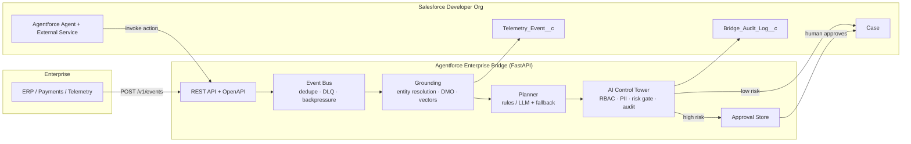
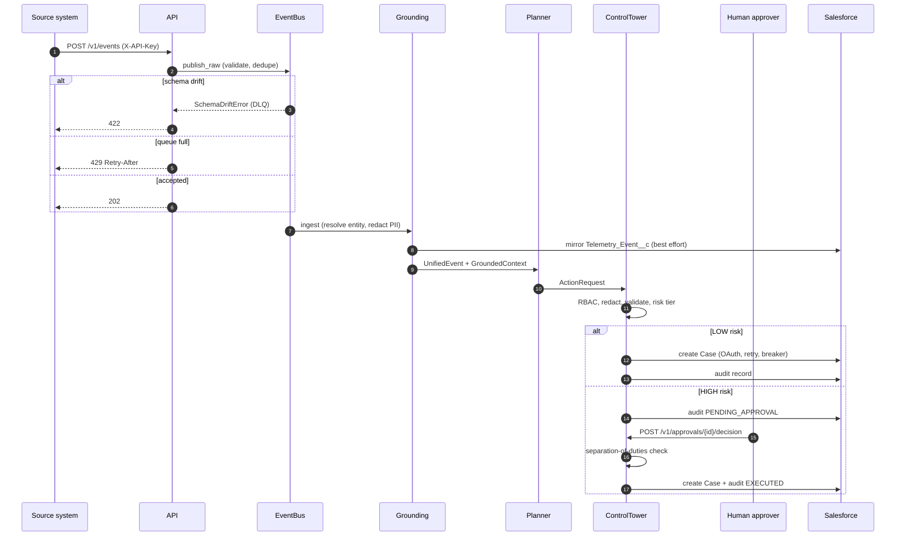
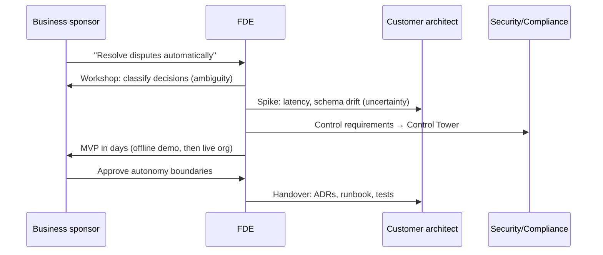
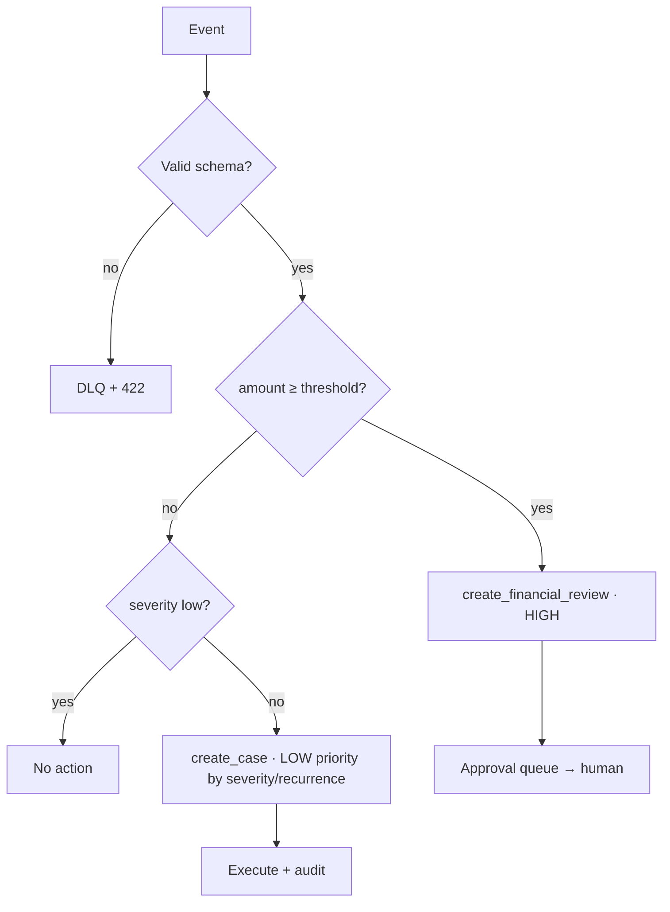
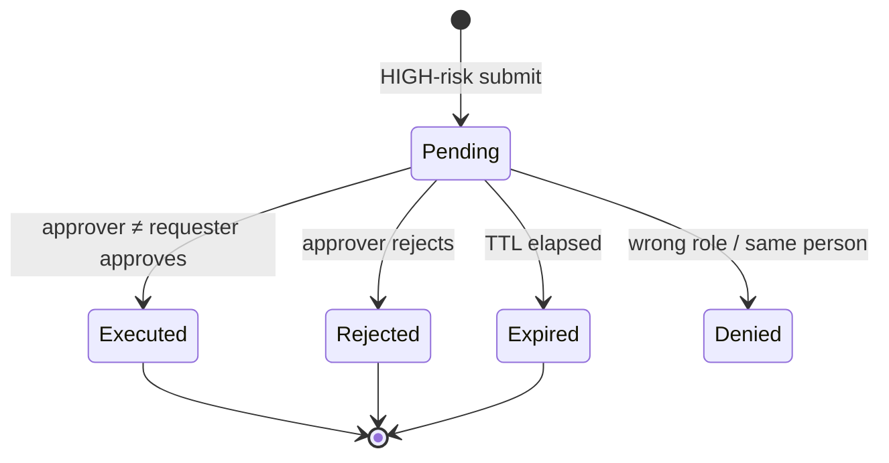
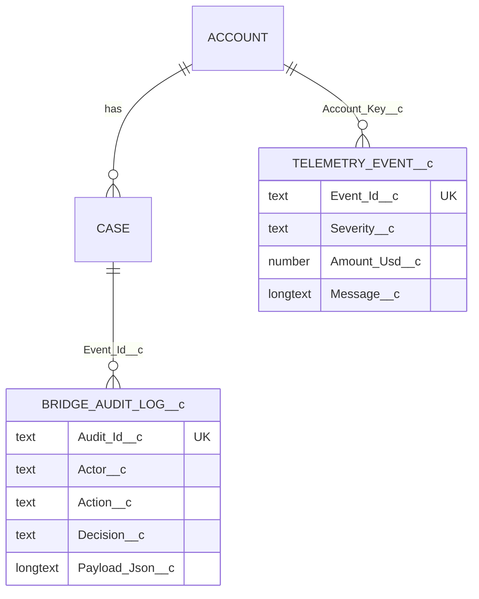
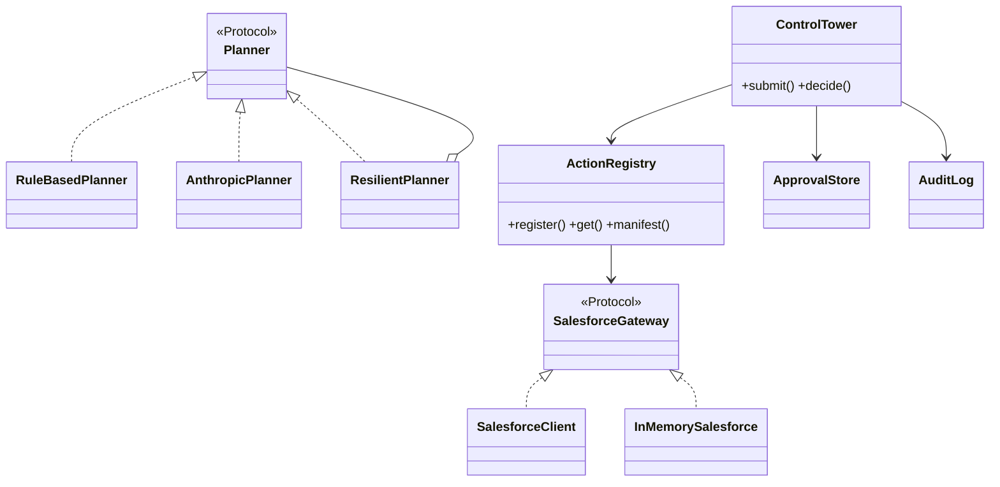
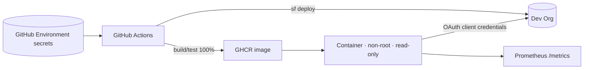

# Solution Explanation

## 1. Problem & approach
Enterprise signals (ERP, payments, telemetry) are fragmented; agents acting on them hallucinate, leak PII, and take irreversible actions without oversight. The bridge enforces: **ground first, plan second, govern every tool call, audit everything**.

## 2. System context

## 3. Sequence — event to governed action

## 4. Customer interaction (discovery → delivery)

## 5. Decision flow

## 6. Approval state machine

## 7. Data model

## 8. Class overview

## 9. Deployment

## 10. AI best practices implemented
| Practice | Where |
|---|---|
| Ground before generate; scope context per tenant | `grounding.py` (per-account index) |
| Untrusted-input framing & prompt-injection containment | `agent.py` system prompt; LLM output can only *propose* — Control Tower still enforces RBAC/HITL |
| Constrained, validated outputs | JSON-only, allow-listed actions, pydantic validation twice |
| Deterministic fallback / graceful degradation | `ResilientPlanner` + metric `planner_fallback` |
| PII minimisation before prompt, audit, CRM | `pii.py` at ingest and at tool call |
| Risk-tiered human-in-the-loop, separation of duties | `actions.RiskTier`, `ControlTower.decide` |
| Full auditability, tamper-evident-ish append log | `audit.py` → `Bridge_Audit_Log__c` |
| Evaluation as tests | planner policy tests, adversarial LLM-output tests |
| Observability | `/metrics`, decision counters, latency quantiles |

## 11. Resilience & performance
Backoff `U(0, min(5s, 0.2·2ⁿ))`; breaker opens after 5 consecutive 5xx/transport failures, half-opens after 30s; 401 → token refresh; 4xx not retried (and don't trip breaker). Bus is bounded (O(1) enqueue, 429 backpressure); dedupe and history are bounded LRU/FIFO (O(1)); vector recall is O(n log k) over ≤100 docs per account; approval store O(1) with lazy expiry. Measured offline (in-memory CRM, 1 core): ~2.5k events/s, p50 0.38 ms, p95 0.51 ms — this excludes real Salesforce network latency.

## 12. Security
Salesforce auth is key-based by default: an RS256 JWT assertion (180 s lifetime) signed with a private key that never leaves the host; only the certificate is uploaded to Salesforce (`jwt_auth.py`). Client-credentials remains a fallback.

Secrets only via env / GitHub Environment secrets; masked in `repr`; constant-time API-key compare; fail-closed auth; SOQL escaping + sObject/Id validation; least-privilege permission set; non-root read-only container; CodeQL + pip-audit.

## 13. How to improve
1. Replace `EventBus` internals with a Kafka consumer group (key by account for ordering; commit offsets after handling; DLQ topic).
2. Persist approvals + audit outbox in Postgres/Redis for HA and restarts; use Audit_Id__c upsert for exactly-once audit.
3. Real Data Cloud: Streaming Ingestion API / zero-copy federation from Snowflake/Databricks; Data Cloud vector search replaces `VectorIndex`.
4. Platform Events / Pub-Sub API for Salesforce→bridge callbacks; Flow-based approval in Salesforce.
5. LLM eval harness (golden set, LLM-as-judge, regression gate in CI), tracing (OpenTelemetry), per-tenant rate limits, OAuth/JWT inbound instead of API keys.
6. Single-probe half-open breaker; Retry-After awareness; React approver console.
